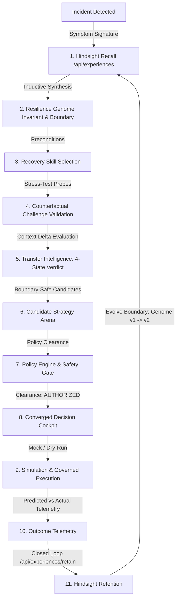

# FULFILL-X (CASCADE) — Continuous Resilience Intelligence Operating System

> **Version**: Production Release v2.3.0  
> **Status**: Fully Integrated, Hardened & Competition Verified  
> **Backend Tests**: 313/313 Passed (100% Pass Rate in 98.31s)  
> **Frontend**: Zero TypeScript Errors (`tsc --noEmit`), Optimized Vite Production Bundle  

---

## 1. What is CASCADE?

**CASCADE** (built on the **FULFILL-X** platform) is an enterprise resilience operating system that transforms reactive supply chain mitigation into a continuous, self-improving experiential learning loop.

Unlike traditional AI agent platforms where models see an incident, reason, and act in isolation without learning from past failures, CASCADE couples:
- **Spatial 2D/3D Digital Twins** with deterministic risk engine propagation
- **Deep Intelligence Studios** (Graph Neural Networks, Structural Causal DAGs, Predictive ML)
- **Multi-Agent Specialist Swarms** with adversarial stress-testing
- **Hindsight Experiential Memory**, capturing failure boundaries, invariant genomes, and counterfactual challenges
- **Governed Decision Convergence**, enforcing strict safety invariants before execution

```
OLD WORLD (Standard Agent):
Incident → Prompt → LLM Reasons → Action (Repeats the same mistakes tomorrow)

CASCADE (Continuous Resilience Intelligence):
Incident → Hindsight Recalls Prior Experiences → Inductive Reflection Extracts Genome
→ Recovery Skill Declares Boundaries → Adversary Challenges → Transfer Intelligence Verifies
→ Deep Intelligence Quantifies Impact → Policy Engine Authorizes → Governed Execution
→ Outcome Measured → Retained to Hindsight → Future Behavior Changes
```

---

## 2. Why Hindsight?

### "Why not just RAG?"
> **RAG answers "What happened?"** — it retrieves text or past documents.  
> **Hindsight answers "What generalizes, where does it break, and does it transfer to this exact context?"**  
> RAG retrieves information; Hindsight provides an experiential substrate that extracts failure boundaries, detects contradictions, and conditions future governed actions.

### "Why not just a Runbook?"
> A runbook encodes static procedures. A **Recovery Skill** in CASCADE is an evolving capability whose applicability conditions, challenge history, failure boundaries, and transfer metrics continuously adapt as operational outcomes accumulate.

---

## 3. How It Learns: The Closed Resilience Loop



---

## 4. The Hero Moment: "Why Did the Decision Change?"

In Incident #1, supplier substitution succeeded because the substitute had 45% spare capacity.  
In Incident #2, a nearly identical disruption strikes. A standard LLM repeats the substitution and fails.

**In CASCADE, the Decision Cockpit displays the dedicated hero panel:**
```text
┌────────────────────────────────────────────────────────────────────────┐
│ WHY DID THE DECISION CHANGE?                                           │
├────────────────────────────────────────────────────────────────────────┤
│ Previous Experience:                                                   │
│   Supplier substitution succeeded in Incident #1 (EXP-012)             │
│                                                                        │
│ Learned Invariant & Boundary (GENOME-03):                              │
│   Supplier Spare Capacity >= 40.0% & Lead Time <= 72h                  │
│                                                                        │
│ Current Observed Condition:                                            │
│   Supplier Spare Capacity = 38.0% (Boundary Breach Detected!)          │
│                                                                        │
│ Transfer Verdict:                                                      │
│   PARTIAL / UNCERTAIN                                                  │
│                                                                        │
│ Resulting Authoritative Action:                                        │
│   Previous strategy REJECTED to avoid boundary failure                 │
│   ↳ Alternative Selected: Multi-Modal Buffer Rerouting + Air Expedite  │
└────────────────────────────────────────────────────────────────────────┘
```
**Memory is not the end product. Observable behavioral change is.**

---

## 5. Proven Evaluation Benchmark (Section 85)

Reproducible from the evaluation harness (`backend/tests/test_evaluation.py` and `artifacts/evaluation/evaluation.json`) across 30 deterministic stress-test episodes:

| Metric | Memoryless Agent | Hindsight Agent (CASCADE) | Difference |
|---|---|---|---|
| **Recovery Success Rate** | 43.3% (13/30) | **93.3% (28/30)** | **+50.0 percentage points** |
| **Repeated Mistake Rate** | 43.3% (13/30) | **0.0% (0/30)** | **-43.3 pp (Eliminated)** |
| **Unsafe Action Rate** | 56.7% (17/30) | **3.3% (1/30)** | **-53.4 pp (Safe)** |
| **Boundary Avoidance Rate**| 0.0% (0/30) | **46.7% (14/30)** | **+46.7 pp (Boundary-Aware)**|
| **Evidence Reuse Rate** | 0.0% | **96.7% (29/30)** | **+96.7 pp** |
| **Avg Prediction Error** | 2.32 hours | **0.39 hours** | **-83.2% error reduction** |

---

## 6. Architecture & Deep Intelligence Studios

| Studio / Layer | Component | Truth Mode | Purpose |
|---|---|---|---|
| **Executive Command Center** | `/command` | `OBSERVED` | Real-time global network telemetry & resilience pulse |
| **3D Geographic Twin** | `/world` | `OBSERVED` | Interactive 3D spatial network (React Three Fiber + Drei) |
| **Stochastic Twin** | `/twin` | `SIMULATED` | 1,000-run Monte Carlo simulation for P50/P90 confidence bounds |
| **GNN Graph Intelligence** | `/intelligence/gnn` | `INFERRED` | Multi-hop topological contagion forecasting |
| **Causal Intelligence DAG** | `/intelligence/causal` | `INFERRED` | Structural causal identification & counterfactual `do(X)` |
| **Predictive ML Engine** | `/intelligence/predictive`| `PREDICTED` | Disruption probability & Population Stability Index (PSI) drift |
| **Specialist War Room** | `/war-room` | `INFERRED` | Autonomous multi-agent swarm deliberation & consensus |
| **Adversary Attack Lab** | `/agents/adversary` | `SIMULATED` | Probes stress-test envelopes & discovers boundary limits |
| **Decision Cockpit** | `/decision/cockpit` | `AUTHORIZED` | Converged Decision Clearance & Safety Clearance |
| **Experience Memory** | `/experiences` | `LEARNED` | Episodic memory repository with contradiction detection |
| **Resilience Genome** | `/genomes` | `LEARNED` | Invariant synthesis, evidence weights & reflection trigger |
| **Competition Demo Engine** | `/demo` | `DETERMINISTIC` | 5 scripted demonstration scenarios with automated reports |

---

## 7. Safety, Governance & Demo Contract

- **Demo Safety**: FULFILL-X uses a deterministic `MockExecutionProvider` and `DRY_RUN` simulation pipeline. It never triggers real destructive cloud mutations or unsafeguarded financial transactions.
- **Deterministic Reset**: Complete state reset via single endpoint (`POST /api/demo/reset`), restoring world state, active incident, memory state, and verification status without cache contamination.
- **Decision Language Standards**: Avoids "the AI knows"; uses calibrated probabilities, policy rule validations, and explicit boundary statuses (`KNOWN`, `PROBABLE`, `UNCERTAIN`, `UNKNOWN`).

---

## 8. Honest Accounting of Limitations (Section 95)

To maintain technical credibility:
1. **Synthetic MVP Telemetry**: Current demonstrations use deterministic synthetic network data rather than live enterprise ERP feeds.
2. **Finite Challenge Space**: Counterfactual probes cover critical capacity, demand, and lead-time dimensions, but cannot cover all black-swan edge cases.
3. **Transfer Uncertainty**: Cross-network transfer is evaluated as `PARTIAL` or `UNCERTAIN` when domain distance is high, intentionally requiring human oversight.
4. **Human-in-the-Loop Requirement**: High-risk financial or operational decisions (> $10,000 auto-limit) require explicit executive signoff.

---

## 9. Quick Start

### Prerequisites
- Python 3.11+
- Node.js 18+ and npm

### 1. Launch Backend Server
```bash
cd backend
python -m venv .venv
# Activate virtual environment:
# Windows: .venv\Scripts\activate
# Linux/macOS: source .venv/bin/activate
pip install -r requirements.txt
python -m uvicorn app.main:app --host 127.0.0.1 --port 8000
```
Backend API will be live at `http://127.0.0.1:8000` with Swagger docs at `/docs`.

### 2. Launch Frontend Dev Server
```bash
cd frontend
npm install
npm run dev
```
Open `http://localhost:5173` to explore the full platform.

### 3. Run Automated Test Suite
```bash
cd backend
python -m pytest
# 313 passed in ~98s
```

### 4. Build Production Bundle
```bash
cd frontend
npm run build
# Built in ~10s (2,623 modules transformed, 0 errors)
```

---

## 10. Key Specification & Audit Documents

| Document | Description |
|---|---|
| [`docs/DEMO_SCREENPLAY.md`](docs/DEMO_SCREENPLAY.md) | Synchronized 5-minute video screenplay with time, screen, action, and narration |
| [`docs/HINDSIGHT_CENTRALITY_AUDIT.md`](docs/HINDSIGHT_CENTRALITY_AUDIT.md) | Static architectural audit verifying Hindsight's direct information dependency |
| [`docs/PHASE_6G_6H_6I_FINAL_COMPLETION.md`](docs/PHASE_6G_6H_6I_FINAL_COMPLETION.md) | Comprehensive engineering release and verification report |
| [`docs/HANDOFF.md`](docs/HANDOFF.md) | Complete session handoff log for seamless continuity |
| [`artifacts/demo/demo_report.md`](artifacts/demo/demo_report.md) | Automatically generated competition demonstration execution trace |
| [`LICENSES/THIRD_PARTY.md`](LICENSES/THIRD_PARTY.md) | Third-Party Open Source License Notices |

---

*FULFILL-X / CASCADE — Built with pride for enterprise resilience.*
