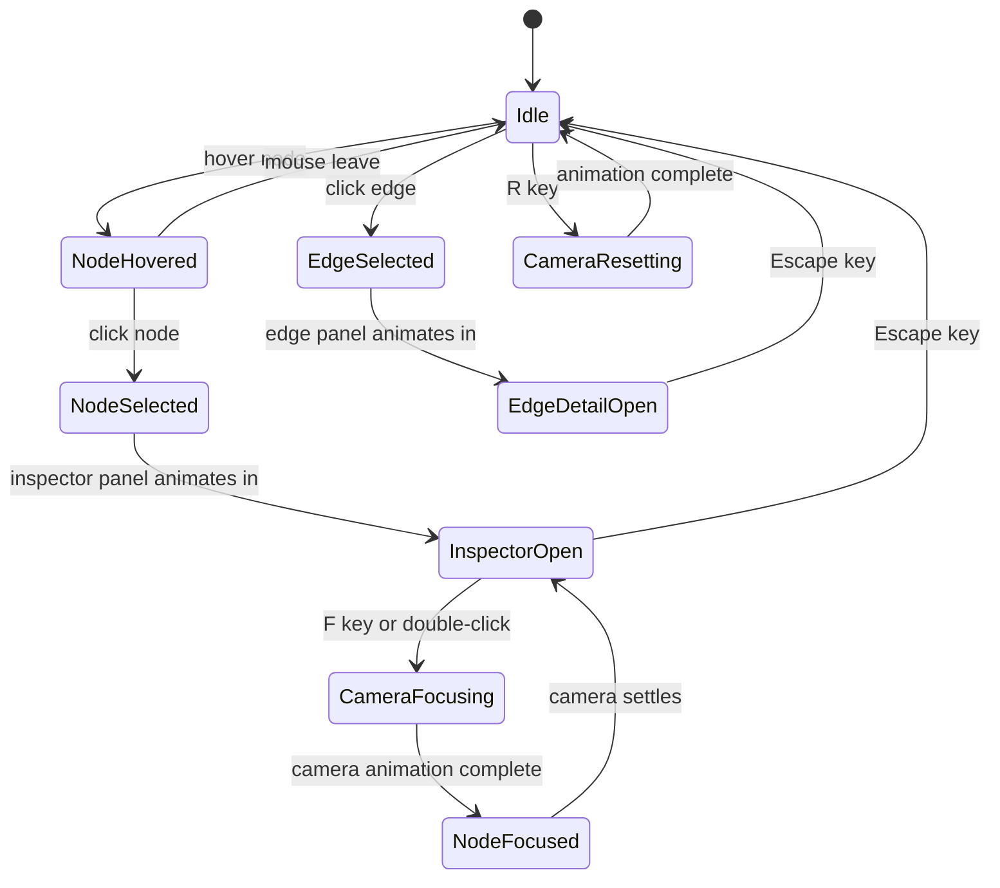

# FULFILL-X — 3D Interaction Map

## 1. Purpose

Map all user interactions with the 3D world model: what the user can do,
what triggers each behavior, and what feedback they receive.

## 2. Interaction Inventory

### 2.1 Camera Controls

| Interaction | Device | Behavior | Animation |
|------------|--------|---------|-----------|
| Drag | Mouse left | Orbit camera around scene | Smooth, no snap |
| Scroll | Mouse wheel | Zoom in/out | Smooth linear |
| Shift + Drag | Mouse | Pan camera | Smooth |
| Two-finger drag | Touch | Pan | Smooth |
| Pinch | Touch | Zoom | Smooth |
| `R` key | Keyboard | Reset camera to default | GSAP 800ms ease-in-out |
| `F` key | Keyboard | Focus on selected node | GSAP 800ms ease-in-out |
| Double-click node | Mouse | Fly in close to node | GSAP 1200ms ease-in-out |

### 2.2 Node Interactions

| Interaction | Behavior | Visual Feedback | Data Effect |
|------------|---------|----------------|------------|
| Click node | Select node; open inspector panel | Node emissive increases; ring appears | `selectedNodeId` set in Zustand |
| Hover node | Tooltip with name + risk score | Node scale + 5% | None |
| Right-click node | Context menu | Menu appears at cursor | None |
| Context: "Highlight Neighbors" | All neighbors glow | Non-neighbors fade to 20% opacity | None |
| Context: "View in Risk Explorer" | Navigate to Risk Explorer | Screen transition | Route change |
| Context: "Pin Node" | Node stays visible during filter | Pin icon appears above node | `pinnedNodeIds` in Zustand |

### 2.3 Edge Interactions

| Interaction | Behavior | Visual Feedback | Data Effect |
|------------|---------|----------------|------------|
| Click edge | Open edge detail panel | Edge line thickens + glows | `selectedEdgeId` in Zustand |
| Hover edge | Tooltip with route info | Edge glows | None |

### 2.4 Control Panel Interactions

| Control | Effect | 3D Change |
|---------|--------|-----------|
| Risk Heatmap toggle | Show/hide risk color overlay | Nodes lerp to risk color |
| Particle Flow toggle | Show/hide route particles | Particle system enable/disable |
| Agent Overlay toggle | Show/hide agent icons | Agent orbit sprites show/hide |
| Node Type filter | Show only selected types | Other nodes fade to 10% opacity |
| Reset Filters | Show all | All nodes return to full opacity |

### 2.5 Keyboard Shortcuts

| Key | Action |
|-----|--------|
| `Esc` | Deselect all; close panels |
| `R` | Reset camera |
| `F` | Focus on selected node |
| `H` | Toggle risk heatmap |
| `P` | Toggle particle flow |
| `1`–`4` | Filter by node type (1=Supplier, 2=Warehouse, 3=FC, 4=Customer) |

---

## 3. State Transitions

---

## 4. Data-to-3D Update Flow

When world state updates via WebSocket (`world.update`):

1. Zustand `worldSnapshot` updated
2. `useFrame` hook in `NodeLayer` reads new `riskScores`
3. Each node's color material lerps from current → target color (400ms)
4. Disrupted nodes trigger `DisruptionWave` component to animate
5. New/removed nodes animate in/out via scale (0 → 1, 300ms)
6. Changed edges update their tube geometry on next render frame

---

## 5. Performance Guards

| Trigger | Guard | Action |
|---------|-------|--------|
| Frame rate drops below 30fps | `renderer.info.render.frame` | Disable post-processing |
| Node count > 200 | Always | Switch to instanced mesh |
| Node count > 500 | Always | Enable LOD (detail reduction at distance) |
| Particle count > 10,000 | Always | GPU instancing mode |

---

## 6. Accessibility (3D Fallback)

Users with WebGL unavailable or who prefer no 3D get a 2D network graph
rendered with React Flow, using the same node/edge data. All interactions
(select, filter) work identically in the 2D fallback.

Keyboard users can navigate the node list via `Tab`/`Arrow` keys; each
focused node is announced by screen reader with name, type, and risk score.

---

## 7. Animation Timeline Reference

| Event | Library | Duration | Easing |
|-------|---------|---------|--------|
| Camera orbit | OrbitControls | Continuous | Auto-damping |
| Camera focus/reset | GSAP | 800ms | power2.inOut |
| Camera fly-in | GSAP | 1200ms | power3.inOut |
| Node color risk update | lerp in useFrame | 400ms | Linear |
| Node selection ring | Framer Motion (CSS) | 200ms | ease-out |
| Disruption wave | Three.js shader | 2000ms loop | ease-out |
| Agent orbit icon | CSS rotation | Infinite | Linear |
| Plan reroute new edge | Three.js TubeGeometry grow | 600ms | ease-in-out |
| Panel appear (inspector) | Framer Motion | 250ms | ease-out |
