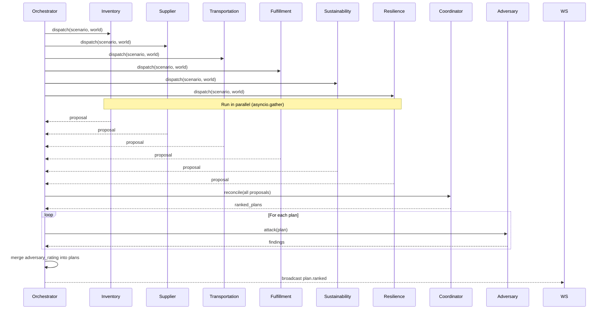

# FULFILL-X — Agent Specification

## 1. Purpose

Define the complete contract for all 8 specialist agents: inputs,
outputs, objectives, constraints, tools, failure behavior, and
UI representation.

## 2. Agent Base Contract

Every agent implements the `BaseAgent` protocol:

```python
class BaseAgent(ABC):
    id: AgentId
    name: str
    description: str
    objective: str
    system_prompt: str
    input_schema: type[BaseModel]
    output_schema: type[BaseModel]
    constraints: list[Constraint]
    timeout_seconds: float = 30.0
    ai_provider: AIProvider

    @abstractmethod
    async def execute(self, input: AgentInput) -> AgentResult:
        """Run the agent pipeline: prompt → validate → simulate → result."""
        ...

    @abstractmethod
    def build_prompt(
        self,
        input: AgentInput,
        world_state: WorldStateSnapshot,
    ) -> str:
        """Build the user prompt from input and world state."""
        ...
```

### Common Input Schema

```python
class AgentInput(BaseModel):
    scenario: ScenarioObject
    world_state: WorldStateSnapshot
    risk_scores: RiskScoreMap
    constraints: ConstraintSet
    context: dict = {}
```

### Common Output Schema

```python
class AgentOutput(BaseModel):
    objective: str
    reasoning: str          # concise, operational — never raw chain of thought
    evidence: list[str]
    actions: list[ProposalAction]
    constraint_satisfaction_score: float
    feasibility_score: float
    confidence: float
```

---

## 3. Agent Contracts

### 3.1 Inventory Agent

**ID**: `inventory`
**Name**: Inventory Agent
**Objective**: Minimize stockout risk across all fulfillment centers

**Input**:
- World state (inventory levels at all nodes)
- Disrupted supplier IDs
- Demand forecast per customer zone
- Safety stock thresholds

**Output**:
- Reorder actions (node, quantity, urgency)
- Stock rebalancing transfers (source node, target node, quantity)
- Buffer stock recommendations

**Constraints**:
- Cannot exceed warehouse capacity
- Cannot transfer more than available inventory
- Transfers have minimum lead time
- Cost per unit transfer must be ≤ max_transfer_cost

**Tools**:
- `get_inventory_levels(node_ids)` → dict
- `get_demand_forecast(zone_id, horizon_hours)` → float
- `calculate_stockout_risk(node_id)` → float

**Failure Behavior**:
- AI timeout: return current safety stock recommendation (deterministic fallback)
- Infeasible proposal: reduce quantities until feasible

**UI Representation**:
- Agent card color: `#4A90D9` (blue)
- Shows: reorder count, highest-risk node, cost estimate
- Bar chart: inventory levels before vs. after

---

### 3.2 Supplier Agent

**ID**: `supplier`
**Name**: Supplier Agent
**Objective**: Reduce supplier disruption impact on the supply network

**Input**:
- World state (supplier nodes + their risk scores)
- Active signals affecting suppliers
- Alternative supplier registry

**Output**:
- Supplier switch recommendations (from, to, reason)
- Dual-sourcing proposals
- Supplier escalation flags

**Constraints**:
- Alternative supplier must be pre-qualified
- Lead time difference must be within acceptable range
- Switching cost must be ≤ budget threshold

**Tools**:
- `get_supplier_alternatives(supplier_id)` → list[Supplier]
- `get_supplier_risk(supplier_id)` → SupplierRisk
- `get_switch_cost(from_id, to_id)` → float

**Failure Behavior**:
- No alternatives: flag for human review
- Timeout: return top 3 suppliers by risk score for review

**UI Representation**:
- Agent card color: `#7BC67E` (green)
- Shows: switch count, risk reduction estimate
- Network diagram: highlighted supplier alternatives

---

### 3.3 Transportation Agent

**ID**: `transportation`
**Name**: Transportation Agent
**Objective**: Minimize fulfillment delay and cost across all routes

**Input**:
- World state (all edges/routes + load + delay + cost)
- Disrupted routes
- Alternative route registry

**Output**:
- Route rerouting recommendations (from, to, alternative)
- Mode switches (sea → air for critical SKUs)
- Capacity reservation actions

**Constraints**:
- Alternative route must exist in the network graph
- Mode switch cost must be feasible within budget
- Lead time change must be communicated to downstream nodes

**Tools**:
- `find_alternative_routes(source, target, max_hops)` → list[Route]
- `get_route_delay(edge_id)` → float
- `get_mode_options(source, target)` → list[TransportMode]

**Failure Behavior**:
- No alternative routes: recommend emergency air freight + flag cost
- Timeout: return current routes sorted by delay

**UI Representation**:
- Agent card color: `#E8A24A` (amber)
- Shows: rerouted count, delay reduction, cost delta
- Animated routes on 3D world: new paths glow

---

### 3.4 Fulfillment Agent

**ID**: `fulfillment`
**Name**: Fulfillment Agent
**Objective**: Protect service-level agreements across all customer zones

**Input**:
- World state (fulfillment centers + SLA commitments + order backlogs)
- Current SLA risk per customer zone
- Priority customer list

**Output**:
- Order priority adjustments
- Fulfillment center allocation changes
- SLA exception notifications (which customers to notify, why)

**Constraints**:
- Priority customers must maintain minimum SLA
- Cannot over-commit fulfillment center capacity
- Exception notifications must be factual and conservative

**Tools**:
- `get_sla_commitments(zone_id)` → SLAContract
- `get_backlog(fc_id)` → int
- `get_priority_customers()` → list[Customer]

**Failure Behavior**:
- SLA breach unavoidable: generate exception notification draft
- Timeout: return current SLA risk sorted by impact

**UI Representation**:
- Agent card color: `#9B7FE8` (purple)
- Shows: SLA at-risk count, protected SLA count
- SLA gauge per customer zone

---

### 3.5 Sustainability Agent

**ID**: `sustainability`
**Name**: Sustainability Agent
**Objective**: Minimize emission increase from disruption response

**Input**:
- All proposed actions from other agents
- Emissions per unit per route mode
- ESG targets

**Output**:
- Emission delta for each proposed action
- Lower-emission alternatives
- ESG compliance flag (pass/fail)

**Constraints**:
- Total emissions delta must not exceed ESG threshold
- Air freight alternatives must be flagged with emissions cost
- Recommendations must not violate SLA commitments

**Tools**:
- `get_emissions_factor(route_id, mode)` → float
- `get_esq_threshold()` → float
- `calculate_emission_delta(actions)` → float

**Failure Behavior**:
- All alternatives exceed threshold: flag ESG breach + recommend offset options
- Timeout: return emission estimate using average factors

**UI Representation**:
- Agent card color: `#52B788` (forest green)
- Shows: emissions delta kg CO2e, ESG flag
- Bar chart: emissions by action

---

### 3.6 Resilience Agent

**ID**: `resilience`
**Name**: Resilience Agent
**Objective**: Reduce systemic fragility — single points of failure, concentration risk

**Input**:
- World state (full graph)
- Current single-point-of-failure analysis
- Historical disruption patterns

**Output**:
- Fragility hotspot identification
- Diversification recommendations
- Resilience score delta estimate

**Constraints**:
- Recommendations must be actionable within 72 hours
- Cannot recommend eliminating a node without alternative

**Tools**:
- `analyze_single_points_of_failure(graph)` → list[SPOF]
- `compute_resilience_score(graph)` → float
- `get_historical_disruptions(node_id)` → list[DisruptionEvent]

**Failure Behavior**:
- Graph analysis timeout: return last cached resilience scores
- No actionable recommendations: return fragility report only

**UI Representation**:
- Agent card color: `#E8574A` (red-orange)
- Shows: SPOF count, resilience score change
- Network graph: SPOFs highlighted in red

---

### 3.7 Coordinator Agent

**ID**: `coordinator`
**Name**: Coordinator Agent
**Objective**: Reconcile proposals from all specialist agents into ranked, coherent plans

**Input**:
- All specialist agent proposals
- World state
- Objective weights (cost, SLA, emissions, fragility)
- Constraint set

**Output**:
- Ranked plan list (up to 5 plans)
- For each plan: composite score, trade-off explanation, recommended actions

**Constraints**:
- Plans must not contain conflicting actions
- Constraint satisfaction scores must be > 0.5
- Ranking must be deterministic given same inputs + weights

**Tools**:
- `score_proposal(proposal, weights)` → float
- `detect_conflicts(proposals)` → list[Conflict]
- `merge_compatible_proposals(proposals)` → Plan

**Failure Behavior**:
- No feasible plan: return single minimum-damage plan with explanation
- Conflict resolution fails: present two incompatible options for human selection

**UI Representation**:
- Agent card color: `#A8B5C5` (neutral)
- Shows: plans ranked, trade-off summary
- Radar chart: plan score dimensions

---

### 3.8 Adversary Agent

**ID**: `adversary`
**Name**: Adversary Agent
**Objective**: Stress-test plans by identifying failure vectors and worst-case scenarios

**Input**:
- A single ranked plan
- World state
- Disruption library (catalog of possible adversarial events)

**Output**:
- List of adversarial findings (attack vector, failure mode, severity, probability)
- Adversarial rating (0.0 = easily broken, 1.0 = robust)
- Mitigation suggestions (informational only — cannot propose plan changes)

**Constraints**:
- Must not propose alternative plans (only attacks and mitigation hints)
- Attack scenarios must be physically realistic
- Cannot exceed 5 findings per plan
- Chain of thought must NOT be exposed; only findings are returned

**Tools**:
- `get_disruption_library()` → list[DisruptionTemplate]
- `simulate_disruption(plan, disruption)` → SimulationResult
- `rate_plan_robustness(findings)` → float

**Failure Behavior**:
- Timeout: return partial findings with `status: PARTIAL`
- No vulnerabilities found: return `adversary_rating = 1.0` with explanation

**UI Representation**:
- Agent card color: `#E85D4A` (red)
- Shows: finding count, adversary rating, highest severity finding
- Attack tree diagram (React Flow)

---

## 4. Agent Identity Colors

| Agent | Color | Hex |
|-------|-------|-----|
| Inventory | Blue | `#4A90D9` |
| Supplier | Green | `#7BC67E` |
| Transportation | Amber | `#E8A24A` |
| Fulfillment | Purple | `#9B7FE8` |
| Sustainability | Forest Green | `#52B788` |
| Resilience | Red-Orange | `#E8574A` |
| Coordinator | Neutral | `#A8B5C5` |
| Adversary | Red | `#E85D4A` |

---

## 5. Agent Orchestration Flow



## 6. Tests

Each agent must have:
- Unit test with mock AI provider (deterministic)
- Constraint violation test
- Timeout test
- Integration test with scenario + world state

See `docs/TESTING_SPEC.md` for full test plan.
