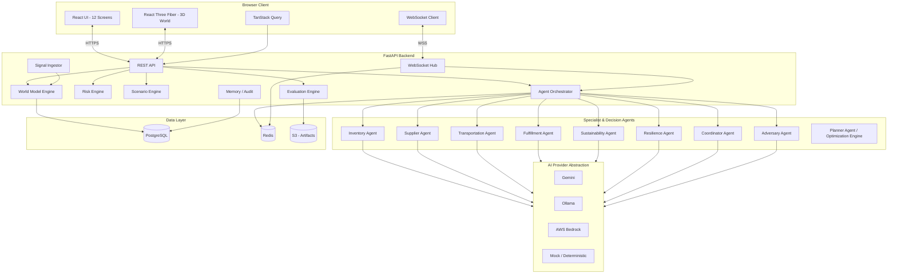
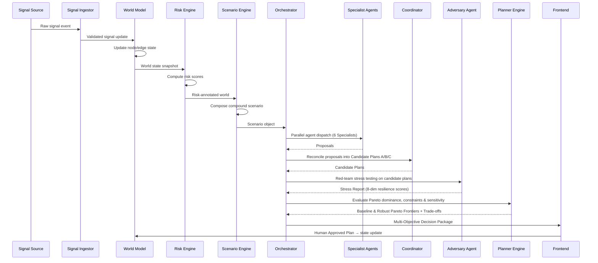

# FULFILL-X — System Architecture

## 1. Purpose

Define the complete, cross-layer technical architecture of FULFILL-X
so that every subsystem can be implemented independently while remaining
synchronized with all others.

## 2. Architecture Layers

```
┌──────────────────────────────────────────────────┐
│                  BROWSER CLIENT                   │
│  React + TypeScript + Vite + Tailwind + shadcn    │
│  React Three Fiber / Three.js / Drei (3D)         │
│  Zustand (local state)                            │
│  TanStack Query (server state)                    │
│  Framer Motion + GSAP (animation)                 │
│  Recharts + React Flow (2D visualization)         │
└────────────────┬─────────────────────────────────┘
                 │ HTTPS / WSS
┌────────────────▼─────────────────────────────────┐
│              API GATEWAY / ALB (AWS)              │
└────────────────┬─────────────────────────────────┘
                 │
┌────────────────▼─────────────────────────────────┐
│               BACKEND (FastAPI)                   │
│  REST API  │  WebSocket Hub  │  Background Tasks  │
│  ──────────────────────────────────────────────── │
│  World Model Engine    │  Risk Engine             │
│  Scenario Engine       │  Simulation Engine       │
│  Agent Orchestrator    │  Evaluation Engine       │
│  Memory / Audit Store  │  Signal Ingestor         │
└──────┬───────────────────────┬────────────────────┘
       │                       │
┌──────▼──────┐        ┌───────▼──────────────────┐
│  PostgreSQL │        │  AI Provider Abstraction  │
│  (State DB) │        │  ┌──────────┬──────────┐ │
│             │        │  │ Gemini   │ Ollama   │ │
│  Redis      │        │  ├──────────┼──────────┤ │
│  (Cache,    │        │  │ Bedrock  │  Mock    │ │
│   Pub/Sub)  │        │  └──────────┴──────────┘ │
└─────────────┘        └──────────────────────────┘
```

## 3. System Architecture Diagram



## 4. Data Flow



## 5. Key Architectural Principles

### 5.1 Determinism First

All state changes are deterministic:
- World state is the single source of truth in PostgreSQL
- AI proposals are validated before state mutation
- Simulation uses seeded random for reproducibility
- Mock provider returns fixed outputs for testing

### 5.2 AI Safety Boundary

```
LLM → Proposal (JSON) → Pydantic Schema Validation →
Constraint Check → Simulator → Accept/Reject →
State Update (if accepted)
```

LLMs never write directly to state. All mutations are mediated by the
constraint engine and simulator.

### 5.3 Interface Stability

All interfaces are typed:
- Backend: Pydantic v2 schemas
- Frontend: TypeScript interfaces
- Agent contracts: documented in `docs/AGENT_SPEC.md`
- API: documented in `docs/API_SPEC.md`

Breaking changes require version bumps and documentation updates.

### 5.4 WebSocket Event Model

The backend pushes real-time updates to the frontend via WebSocket:

| Event | Payload | Trigger |
|-------|---------|---------|
| `world.update` | WorldStateSnapshot | World model change |
| `risk.update` | RiskScoreMap | Risk recalculation |
| `scenario.created` | ScenarioObject | New scenario composed |
| `agent.started` | AgentId + Task | Agent dispatch |
| `agent.proposal` | AgentProposal | Agent proposal ready |
| `adversary.finding` | AdversaryFinding | Adversary result |
| `plan.ranked` | RankedPlanList | Plan ranking complete |
| `plan.accepted` | AcceptedPlan | Plan accepted and applied |
| `eval.result` | EvaluationResult | Evaluation complete |

## 6. Technology Decisions

| Decision | Choice | Rationale |
|----------|--------|-----------|
| Frontend framework | React 18 + Vite | Fast HMR, mature ecosystem |
| 3D engine | Three.js via R3F | Best WebGL ecosystem for React |
| Backend | FastAPI | Async, typed, excellent WebSocket support |
| State DB | PostgreSQL | Reliable, relational, audit-friendly |
| Cache/Pub-Sub | Redis | Fast, supports pub/sub for WebSocket fan-out |
| Container | Docker + ECS Fargate | Serverless containers, no EC2 management |
| AI primary | Gemini | Multimodal, structured output, generous quota |
| AI local | Ollama | Privacy, no latency, deterministic testing |

## 7. Dependencies

- See `docs/BACKEND_SPEC.md` for backend dependency graph
- See `docs/FRONTEND_SPEC.md` for frontend dependency graph
- See `docs/AWS_SPEC.md` for infrastructure dependency graph
- See `LICENSES/THIRD_PARTY.md` for all license attributions

## 8. Failure Modes

| Failure | Detection | Mitigation |
|---------|-----------|-----------|
| AI provider unavailable | HTTP timeout + health check | Fallback to Mock provider |
| Database unreachable | Connection pool error | Circuit breaker + retry |
| WebSocket disconnect | Client heartbeat timeout | Auto-reconnect with backoff |
| Agent timeout | Agent execution timeout | Return partial result + flag |
| Scenario engine error | Uncaught exception | Return safe default state |

## 9. Diagrams

All Mermaid diagram source files are in `diagrams/`:

- `system-architecture.mmd` — Full system topology
- `end-to-end-flow.mmd` — Request lifecycle
- `data-flow.mmd` — Data movement between layers
- `agent-flow.mmd` — Agent orchestration flow
- `risk-propagation.mmd` — Risk propagation model
- `adversarial-loop.mmd` — Adversary agent loop
- `frontend-architecture.mmd` — Component hierarchy
- `aws-architecture.mmd` — AWS service topology
- `deployment-flow.mmd` — CI/CD pipeline

---

*See `docs/DECISION_LOG.md` for all recorded architecture decisions.*
