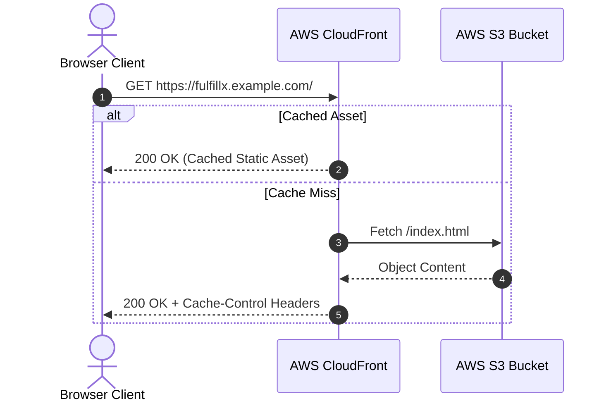
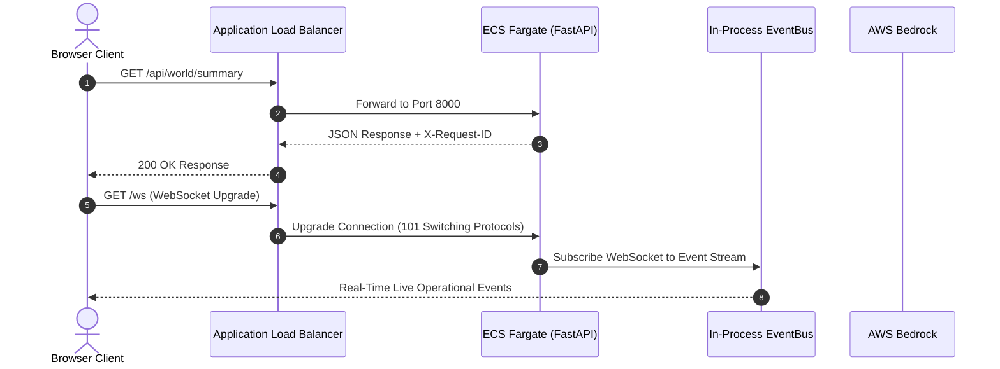

# FULFILL-X — AWS Production Architecture Specification (Phase 14)

---

## 1. System Overview & Deployment Topology

FULFILL-X is deployed on AWS using a serverless container and static distribution model designed for low latency, security isolation, high availability, and cost efficiency.

```text
                               AWS CLOUD TOPOLOGY
                                       │
            ┌──────────────────────────┴──────────────────────────┐
            │                                                     │
   AWS CloudFront CDN                                      AWS ALB (HTTPS)
   (Global Edge Caching)                                (Application Load Balancer)
            │                                                     │
   AWS S3 Static Bucket                                   AWS ECS Fargate Task
  (React + R3F Frontend)                                  (FastAPI Backend Container)
                                                                  │
                                                        AWS Bedrock Boundary
                                                      (Claude 3 / Titan Models)
```

---

## 2. Infrastructure Component Inventory

| Component | AWS Service | Purpose / Configuration |
|-----------|-------------|-------------------------|
| **Frontend CDN** | AWS CloudFront | Global edge distribution, HTTPS termination, static asset caching, SPA fallback routing |
| **Frontend Origin** | AWS S3 Bucket | Private static website hosting for Vite React 18 production bundle (`index.html`, `/assets/`) |
| **Load Balancer** | AWS Application Load Balancer (ALB) | Ingress controller routing HTTPS traffic to ECS tasks on port 8000, `/health` health probing |
| **Backend Container** | AWS ECS Fargate | Serverless container execution (1 vCPU, 2GB RAM), running Python 3.12 Uvicorn ASGI server as non-root user `fulfillx` (UID 10001) |
| **Image Registry** | AWS ECR | Private container repository (`fulfillx-backend`) with image tag immutability and vulnerability scanning |
| **AI Intelligence** | AWS Bedrock | Optional LLM intelligence boundary via `BedrockProvider` using Claude 3 / Titan models |
| **Observability** | AWS CloudWatch | Centralized log group (`/ecs/fulfillx-backend`) and container metric monitoring |
| **Secrets & Config** | AWS SSM Parameter Store / Secrets Manager | Secure runtime environment parameter resolution (`CORS_ORIGINS`, `AI_PROVIDER`, API keys) |

---

## 3. Data & Traffic Flow Architecture

### 3.1 Static Asset & SPA Request Flow


### 3.2 REST API & WebSocket Real-Time Event Flow


---

## 4. Security & Networking Architecture

### 4.1 Security Groups & Least-Privilege Rules

```text
[ Internet ] ──(HTTPS:443)──> [ CloudFront ] ──(HTTPS:443)──> [ ALB Security Group ]
                                                                       │
                                                            (HTTP:8000 from ALB SG)
                                                                       │
                                                                       ▼
                                                           [ ECS Task Security Group ]
                                                                       │
                                                             (Outbound HTTPS:443)
                                                                       │
                                                                       ▼
                                                             [ AWS Bedrock / S3 ]
```

1. **ALB Security Group (`sg-fulfillx-alb`)**:
   - Ingress: `443` (HTTPS) from `0.0.0.0/0`
   - Ingress: `80` (HTTP) from `0.0.0.0/0` (Redirect to HTTPS)
   - Egress: `8000` (HTTP) to `sg-fulfillx-ecs`
2. **ECS Task Security Group (`sg-fulfillx-ecs`)**:
   - Ingress: `8000` from `sg-fulfillx-alb` ONLY
   - Egress: `443` (HTTPS) to internet for AWS Bedrock, ECR, and CloudWatch logs

---

## 5. IAM Least-Privilege Roles

### 5.1 ECS Task Execution Role (`role-fulfillx-execution`)
- `AmazonECSTaskExecutionRolePolicy`
- Read access to SSM parameters (`ssm:GetParameters`, `ssm:GetParameter`)
- CloudWatch log streams (`logs:CreateLogStream`, `logs:PutLogEvents`)

### 5.2 ECS Task Role (`role-fulfillx-task`)
- `bedrock:InvokeModel` and `bedrock:InvokeModelWithResponseStream` (restricted to configured Bedrock model ARNs)
- CloudWatch metrics (`cloudwatch:PutMetricData`)

---

## 6. AWS Bedrock AI Provider Integration

The existing `BedrockProvider` (Phase 04 adapter) connects to AWS Bedrock:

```text
AIService
    ↓
ProviderFactory
    ↓
BedrockProvider (`boto3` client)
    ↓
AWS Bedrock Runtime (`bedrock-runtime.us-east-1.amazonaws.com`)
```

### Deterministic Safety Boundary Assertion
- Bedrock models (`anthropic.claude-3-sonnet-20240229-v1:0`) produce non-authoritative JSON proposals.
- Proposals pass through Pydantic schema validation, deterministic constraint checks, sandbox simulation, and human approval before any world state modification occurs.
- If Bedrock is unconfigured or unreachable, `ProviderFactory` automatically falls back to `MockAIProvider` without breaking execution.

---

## 7. Cost Analysis & Resource Sizing

Estimated monthly AWS operational cost for minimal production deployment:

| Service | Configuration | Estimated Cost / Month |
|---------|---------------|------------------------|
| **AWS ECS Fargate** | 1 Task (0.5 vCPU, 1 GB RAM, 24/7) | ~$15.00 |
| **AWS ALB** | 1 ALB (~0.5 LCU average) | ~$18.00 |
| **AWS CloudFront** | 10 GB Data Transfer Out | ~$0.85 |
| **AWS S3** | 1 GB Storage + GET/PUT requests | ~$0.10 |
| **AWS CloudWatch** | 2 GB Log Storage | ~$1.00 |
| **AWS Bedrock** | Pay-per-token usage (optional) | Usage dependent (~$5.00) |
| **Total Estimated Cost** | | **~$39.95 / month** |
