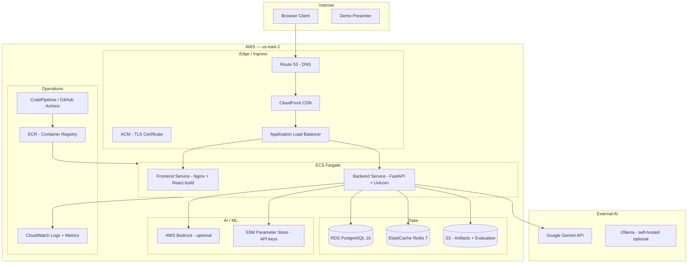
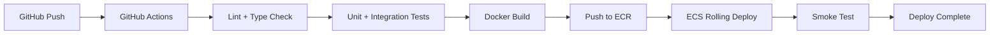

# FULFILL-X — AWS Architecture Specification

## 1. Purpose

Define the complete AWS deployment architecture for FULFILL-X,
including all services, networking, data flow, IAM, and operational
runbooks.

## 2. Guiding Principle

Prefer simple, reliable infrastructure over unnecessary complexity.
Use managed services where possible. Minimize operational overhead.

## 3. Architecture Overview



## 4. Service Inventory

| Service | Purpose | Tier |
|---------|---------|------|
| Route 53 | DNS management | Free (hosted zone) |
| ACM | TLS certificate (auto-renew) | Free |
| CloudFront | CDN for static frontend assets | Standard |
| ALB | HTTP/WebSocket load balancer | Standard |
| ECS Fargate | Serverless container execution | Standard |
| ECR | Docker image registry | Standard |
| RDS PostgreSQL 16 | Authoritative state database | db.t3.medium (demo) |
| ElastiCache Redis 7 | Session cache + WebSocket pub/sub | cache.t3.micro (demo) |
| S3 | Evaluation artifacts, exported reports | Standard |
| SSM Parameter Store | API keys, database credentials | SecureString |
| CloudWatch | Logs, metrics, alarms | Standard |
| CodePipeline | CI/CD pipeline (optional) | Standard |

## 5. Networking

```
VPC: 10.0.0.0/16
├── Public Subnets (2 AZ): 10.0.1.0/24, 10.0.2.0/24
│   └── ALB (internet-facing)
├── Private Subnets (2 AZ): 10.0.11.0/24, 10.0.12.0/24
│   ├── ECS Fargate tasks
│   ├── RDS PostgreSQL
│   └── ElastiCache Redis
└── Internet Gateway + NAT Gateway
```

### Security Groups

| SG | Inbound | Outbound |
|----|---------|----------|
| `sg-alb` | 443 from 0.0.0.0/0 | 8000 to sg-backend |
| `sg-backend` | 8000 from sg-alb | 5432 to sg-rds, 6379 to sg-redis, 443 to 0.0.0.0/0 |
| `sg-rds` | 5432 from sg-backend | None |
| `sg-redis` | 6379 from sg-backend | None |

## 6. ECS Task Definitions

### Backend Task

```json
{
  "family": "fulfillx-backend",
  "cpu": "1024",
  "memory": "2048",
  "networkMode": "awsvpc",
  "containerDefinitions": [
    {
      "name": "backend",
      "image": "<ecr-uri>/fulfillx-backend:latest",
      "portMappings": [{ "containerPort": 8000 }],
      "environment": [
        { "name": "ENVIRONMENT", "value": "production" }
      ],
      "secrets": [
        { "name": "DATABASE_URL", "valueFrom": "arn:aws:ssm:...database-url" },
        { "name": "REDIS_URL", "valueFrom": "arn:aws:ssm:...redis-url" },
        { "name": "GEMINI_API_KEY", "valueFrom": "arn:aws:ssm:...gemini-key" }
      ],
      "logConfiguration": {
        "logDriver": "awslogs",
        "options": {
          "awslogs-group": "/ecs/fulfillx-backend",
          "awslogs-region": "us-east-1",
          "awslogs-stream-prefix": "ecs"
        }
      }
    }
  ]
}
```

### Frontend Task

```json
{
  "family": "fulfillx-frontend",
  "cpu": "256",
  "memory": "512",
  "containerDefinitions": [
    {
      "name": "frontend",
      "image": "<ecr-uri>/fulfillx-frontend:latest",
      "portMappings": [{ "containerPort": 80 }]
    }
  ]
}
```

## 7. ALB Routing

| Rule | Path Pattern | Target |
|------|-------------|--------|
| 1 | `/api/*` | Backend service:8000 |
| 2 | `/ws` | Backend service:8000 (WebSocket upgrade) |
| 3 | `/*` | Frontend service:80 |

WebSocket sticky sessions enabled on ALB.

## 8. CI/CD Pipeline



## 9. IAM Roles

| Role | Permissions |
|------|------------|
| `fulfillx-ecs-task` | SSM:GetParameter, S3:PutObject/GetObject, CloudWatch:PutMetricData, Bedrock:InvokeModel |
| `fulfillx-deploy` | ECR:Push, ECS:RegisterTaskDefinition, ECS:UpdateService |

## 10. Cost Estimate (Demo / Hackathon)

| Service | Monthly (est.) |
|---------|---------------|
| ECS Fargate (backend) | ~$15 |
| ECS Fargate (frontend) | ~$3 |
| RDS db.t3.medium | ~$30 |
| ElastiCache cache.t3.micro | ~$15 |
| ALB | ~$16 |
| CloudFront + S3 | ~$2 |
| **Total** | **~$80/month** |

## 11. Scaling

- ECS Auto Scaling: target CPU 70%, scale to max 4 tasks
- RDS: read replica if needed; no auto-scaling (demo)
- ElastiCache: cluster mode disabled (demo)

## 12. Disaster Recovery (Demo Level)

- RDS automated daily backups (7-day retention)
- ECS tasks restart automatically on failure
- CloudWatch alarm: backend 5xx rate > 5% → alert

## 13. Deployment Runbook

```bash
# 1. Build and push backend image
docker build -t fulfillx-backend ./backend
docker tag fulfillx-backend <ecr-uri>/fulfillx-backend:latest
docker push <ecr-uri>/fulfillx-backend:latest

# 2. Build and push frontend image
docker build -t fulfillx-frontend ./frontend
docker tag fulfillx-frontend <ecr-uri>/fulfillx-frontend:latest
docker push <ecr-uri>/fulfillx-frontend:latest

# 3. Update ECS services
aws ecs update-service --cluster fulfillx --service backend --force-new-deployment
aws ecs update-service --cluster fulfillx --service frontend --force-new-deployment

# 4. Verify
aws ecs describe-services --cluster fulfillx --services backend frontend
```

## 14. Future Extensions

- Multi-AZ RDS with read replica
- WAF for production security
- Private Link for Bedrock
- Terraform IaC for reproducible infra
