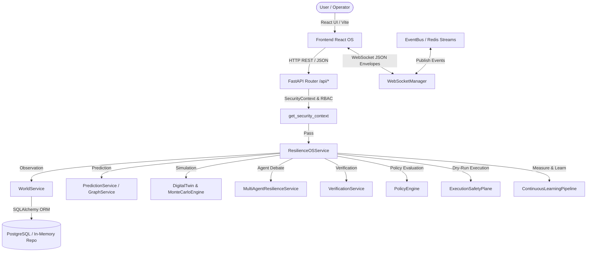
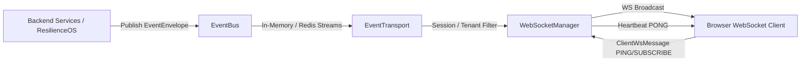
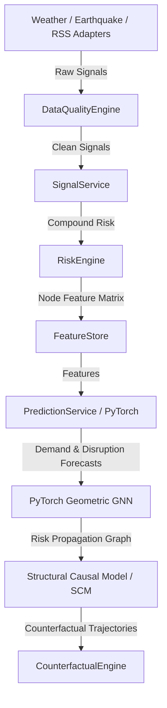
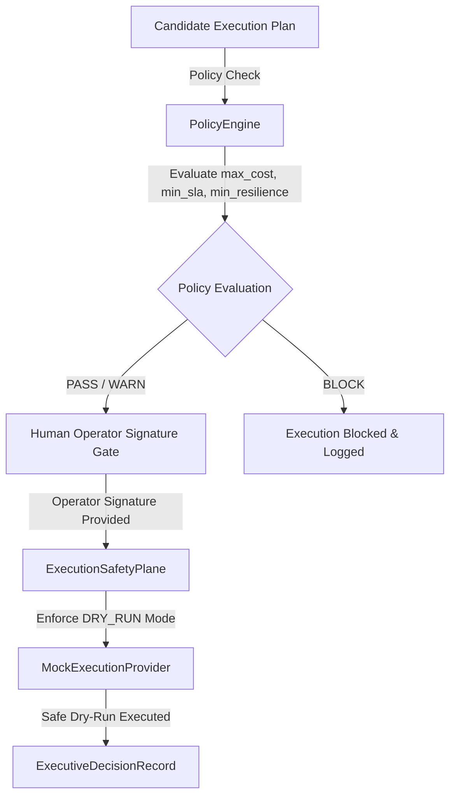

# FULFILL-X — Current Runtime Architecture

## Overview

This document presents the **actual current runtime architecture** of FULFILL-X, derived directly from inspecting source code in `backend/app/`, `frontend/src/`, and `backend/tests/`.

---

## 1. End-to-End Application Flow Architecture



---

## 2. Realtime Event & WebSockets Architecture



---

## 3. Intelligence & Predictive AI/ML Architecture



---

## 4. Simulation & Monte Carlo Twin Architecture

```mermaid
flowchart TD
    WorldSnapshot[WorldStateSnapshot (Production)] -->|Deep Copy / Isolated Snapshot| TwinInstance[DigitalTwin (SIMULATION Mode)]
    TwinInstance -->|Discrete-Time Step (1h Resolution)| DynamicsEngine[DigitalTwinDynamics]
    
    DynamicsEngine -->|Compound Disturbances| ScenarioGen[ScenarioGenerator]
    ScenarioGen -->|Thread/Process Pool (100-5000 runs)| MonteCarloEngine[MonteCarloEngine]
    
    MonteCarloEngine -->|Percentile Metrics (P10, P50, P90)| ResilienceCalc[ResilienceMetricsCalculator]
    ResilienceCalc -->|Resilience Curve & VaR/CVaR| StrategyAnalyzer[RobustStrategyAnalyzer]
```

---

## 5. Multi-Agent Deliberation & Continuous Learning Architecture

```mermaid
flowchart TD
    SpecialistProposals[Inventory, Supplier, Transport, Fulfillment] -->|Proposals| DelibOrchestrator[DeliberationOrchestrator]
    DelibOrchestrator -->|Bounded Debate (Max 3 Rounds)| BoundedDebate[BoundedDebateEngine]
    
    BoundedDebate <-->|Adversary Challenge| AdversaryAgent[AdversaryAgent]
    BoundedDebate <-->|Constraint Validation| VerificationAgent[VerificationAgent]
    
    BoundedDebate -->|DecisionEvidenceBundle| MemoryEngine[AgentMemoryEngine]
    
    ExecutedDecision[Executed Plan Outcome] -->|Actual vs Expected| OutcomeEngine[OutcomeEngine]
    OutcomeEngine -->|Deviations| FeedbackEngine[FeedbackEngine]
    FeedbackEngine -->|Feedback Records| LearnPipeline[ContinuousLearningPipeline]
    
    LearnPipeline -->|Retrain Candidate Model| ChallengerRecord[ChallengerModelRecord]
    ChallengerRecord -->|Human Gate Approval (activate_challenger)| ActiveModel[Active Model Promotion]
    ActiveModel -->|One-Click Safety Rollback| PreviousModel[Rollback Model]
```

---

## 6. Enterprise Governance & Execution Safety Architecture


