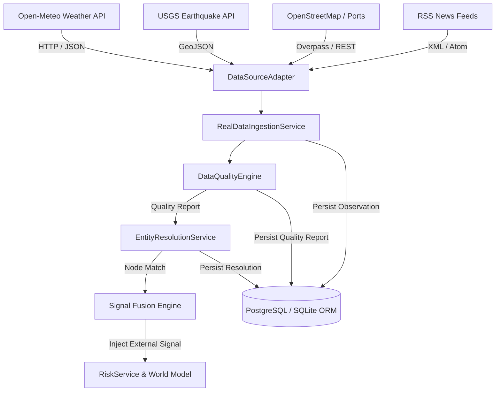

# Real-World Data Integration Architecture

## 1. Overview & Vision
The FULFILL-X Phase 4 Real-World Data Platform connects external supply chain environments (weather anomalies, seismic events, maritime port disruptions, news signals) into the deterministic FULFILL-X World Model and Risk Engine.

Adhering strictly to the **Free-First / Local-First / Open-Data-First** directive, all default operational data feeds consume open-access, keyless Tier A public APIs or local deterministic fallback datasets.

---

## 2. System Architecture & Component Flow

---

## 3. Core Technical Principles

1. **Vendor Neutrality**: All external data protocols implement standard `DataSourceAdapter` contract (`fetch_observations`, `health_check`).
2. **Deterministic Deduplication**: Deduplication across ingestion cycles using exact `source_id + source_record_id + content_hash` keying.
3. **Multi-Tenant Isolation**: Row-level tenancy enforcement on all observations, signals, entity resolutions, and quality reports via `organization_id`.
4. **Resilience & Fallbacks**: In `OFFLINE` or degraded network modes, adapters fall back seamlessly to seed-based deterministic fixtures (`seed=42`).
5. **Prompt Injection Defense**: Text content from external feeds (RSS summaries, unstructured text) undergoes strict sanitization and untrusted tag isolation before ingestion into AI Specialist agent contexts.
