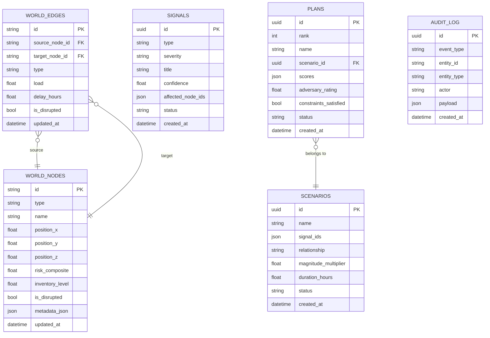

# FULFILL-X — Data Model

## 1. Purpose

Define all core data structures: Pydantic v2 schemas (API/agent layer),
SQLAlchemy ORM models (persistence layer), and TypeScript interfaces
(frontend layer).

---

## 2. Core Domain Entities

### 2.1 NodeType

```python
from enum import StrEnum

class NodeType(StrEnum):
    SUPPLIER = "SUPPLIER"
    WAREHOUSE = "WAREHOUSE"
    FULFILLMENT_CENTER = "FULFILLMENT_CENTER"
    CUSTOMER_ZONE = "CUSTOMER_ZONE"
```

### 2.2 EdgeType

```python
class EdgeType(StrEnum):
    ROUTE = "ROUTE"
    DEPENDENCY = "DEPENDENCY"
    RISK_PROPAGATION = "RISK_PROPAGATION"
```

### 2.3 SignalType

```python
class SignalType(StrEnum):
    WEATHER = "WEATHER"
    GEOPOLITICAL = "GEOPOLITICAL"
    SUPPLIER_HEALTH = "SUPPLIER_HEALTH"
    DEMAND_SHIFT = "DEMAND_SHIFT"
    LOGISTICS = "LOGISTICS"
    REGULATORY = "REGULATORY"
    CYBER = "CYBER"
```

### 2.4 SignalSeverity

```python
class SignalSeverity(StrEnum):
    LOW = "LOW"
    MEDIUM = "MEDIUM"
    HIGH = "HIGH"
    CRITICAL = "CRITICAL"
```

---

## 3. Pydantic Schemas (API Layer)

### 3.1 World Model

```python
from pydantic import BaseModel, Field
from datetime import datetime
from uuid import UUID

class Position3D(BaseModel):
    x: float
    y: float
    z: float

class NodeRiskScores(BaseModel):
    composite: float = Field(ge=0.0, le=1.0)
    financial: float = Field(ge=0.0, le=1.0)
    sla: float = Field(ge=0.0, le=1.0)
    operational: float = Field(ge=0.0, le=1.0)
    sustainability: float = Field(ge=0.0, le=1.0)

class WorldNode(BaseModel):
    id: str
    type: NodeType
    name: str
    position: Position3D
    risk_scores: NodeRiskScores
    inventory_level: float = Field(ge=0.0, le=1.0)
    capacity: float
    is_disrupted: bool
    disruption_source_ids: list[str]
    tags: list[str]
    metadata: dict

class WorldEdge(BaseModel):
    id: str
    source_node_id: str
    target_node_id: str
    type: EdgeType
    load: float = Field(ge=0.0, le=1.0)
    capacity: float
    delay_hours: float
    cost_per_unit: float
    emissions_per_unit: float
    is_disrupted: bool

class WorldStateSnapshot(BaseModel):
    snapshot_id: UUID
    timestamp: datetime
    nodes: list[WorldNode]
    edges: list[WorldEdge]
    network_health_score: float = Field(ge=0.0, le=1.0)
    total_risk_score: float = Field(ge=0.0, le=1.0)
```

### 3.2 Signal

```python
class Signal(BaseModel):
    id: UUID
    type: SignalType
    severity: SignalSeverity
    title: str
    description: str
    confidence: float = Field(ge=0.0, le=1.0)
    region: str
    source: str
    affected_node_ids: list[str]
    geographic_scope: dict  # GeoJSON
    created_at: datetime
    expires_at: datetime | None
    status: Literal["ACTIVE", "DISMISSED", "PROMOTED"]
    raw_data: dict
```

### 3.3 Risk

```python
class RiskScoreMap(BaseModel):
    node_risks: dict[str, NodeRiskScores]
    edge_risks: dict[str, float]
    network_health: float
    highest_risk_nodes: list[str]
    computed_at: datetime
    scenario_id: UUID | None
```

### 3.4 Scenario

```python
class ScenarioRelationship(StrEnum):
    CONCURRENT = "CONCURRENT"
    CASCADING = "CASCADING"
    AMPLIFYING = "AMPLIFYING"

class ScenarioObject(BaseModel):
    id: UUID
    name: str
    signal_ids: list[UUID]
    relationship: ScenarioRelationship
    magnitude_multiplier: float = Field(ge=0.1, le=10.0)
    duration_hours: float
    affected_node_ids: list[str]
    propagation_steps: list[dict]
    risk_delta: NodeRiskScores
    created_at: datetime
    status: Literal["DRAFT", "SIMULATED", "ACTIVE", "RESOLVED"]
```

### 3.5 Agent Proposal

```python
class AgentId(StrEnum):
    INVENTORY = "inventory"
    SUPPLIER = "supplier"
    TRANSPORTATION = "transportation"
    FULFILLMENT = "fulfillment"
    SUSTAINABILITY = "sustainability"
    RESILIENCE = "resilience"
    COORDINATOR = "coordinator"
    ADVERSARY = "adversary"

class ProposalAction(BaseModel):
    action_type: str
    target_node_id: str | None
    target_edge_id: str | None
    parameters: dict
    estimated_cost: float
    estimated_emissions: float
    confidence: float

class AgentProposal(BaseModel):
    id: UUID
    agent_id: AgentId
    scenario_id: UUID
    objective: str
    reasoning: str  # concise operational reasoning, NOT chain of thought
    evidence: list[str]
    actions: list[ProposalAction]
    constraint_satisfaction_score: float = Field(ge=0.0, le=1.0)
    feasibility_score: float = Field(ge=0.0, le=1.0)
    created_at: datetime
    status: Literal["PROPOSED", "INFEASIBLE", "REJECTED", "TIMEOUT", "ACCEPTED"]
```

### 3.6 Plan

```python
class PlanScores(BaseModel):
    cost_delta: float       # negative = cost reduction
    sla_preservation: float = Field(ge=0.0, le=1.0)
    emissions_delta: float  # positive = more emissions
    fragility_delta: float  # negative = less fragile
    composite: float = Field(ge=0.0, le=1.0)

class AdversaryFinding(BaseModel):
    id: UUID
    plan_id: UUID
    attack_vector: str
    failure_mode: str
    severity: SignalSeverity
    probability: float
    mitigation: str | None

class RankedPlan(BaseModel):
    id: UUID
    rank: int
    name: str
    scenario_id: UUID
    proposing_agent_ids: list[AgentId]
    actions: list[ProposalAction]
    scores: PlanScores
    adversary_rating: float = Field(ge=0.0, le=1.0)
    adversary_findings: list[AdversaryFinding]
    constraints_satisfied: bool
    simulation_valid: bool
    created_at: datetime
    status: Literal["PROPOSED", "RANKED", "ACCEPTED", "REJECTED", "DEFERRED"]

class AcceptedPlan(BaseModel):
    plan_id: UUID
    status: Literal["ACCEPTED"]
    applied_at: datetime
    approver_note: str | None
    audit_id: UUID
```

### 3.7 Evaluation

```python
class TestResult(BaseModel):
    test_id: str
    name: str
    status: Literal["PASS", "FAIL", "SKIP", "ERROR"]
    duration_ms: float
    expected: dict
    actual: dict
    error: str | None

class EvaluationResult(BaseModel):
    run_id: UUID
    suite: str
    provider: str
    seed: int
    started_at: datetime
    completed_at: datetime
    total: int
    passed: int
    failed: int
    skipped: int
    results: list[TestResult]
    metrics: dict[str, float]
```

---

## 4. SQLAlchemy ORM Models

```python
from sqlalchemy.orm import DeclarativeBase, Mapped, mapped_column
from sqlalchemy import String, Float, Boolean, JSON, DateTime, ForeignKey
from datetime import datetime
import uuid

class Base(DeclarativeBase):
    pass

class WorldNodeORM(Base):
    __tablename__ = "world_nodes"
    id: Mapped[str] = mapped_column(String, primary_key=True)
    type: Mapped[str] = mapped_column(String)
    name: Mapped[str] = mapped_column(String)
    position_x: Mapped[float] = mapped_column(Float)
    position_y: Mapped[float] = mapped_column(Float)
    position_z: Mapped[float] = mapped_column(Float)
    risk_composite: Mapped[float] = mapped_column(Float)
    inventory_level: Mapped[float] = mapped_column(Float)
    is_disrupted: Mapped[bool] = mapped_column(Boolean)
    metadata_json: Mapped[dict] = mapped_column(JSON)
    updated_at: Mapped[datetime] = mapped_column(DateTime)

class AuditLogORM(Base):
    __tablename__ = "audit_log"
    id: Mapped[str] = mapped_column(String, primary_key=True, default=lambda: str(uuid.uuid4()))
    event_type: Mapped[str] = mapped_column(String)
    entity_id: Mapped[str] = mapped_column(String)
    entity_type: Mapped[str] = mapped_column(String)
    actor: Mapped[str] = mapped_column(String)
    payload: Mapped[dict] = mapped_column(JSON)
    created_at: Mapped[datetime] = mapped_column(DateTime, default=datetime.utcnow)
```

---

## 5. TypeScript Interfaces (Frontend)

```typescript
// world.ts
export interface Position3D { x: number; y: number; z: number; }
export interface NodeRiskScores {
  composite: number; financial: number;
  sla: number; operational: number; sustainability: number;
}
export interface WorldNode {
  id: string; type: NodeType; name: string;
  position: Position3D; riskScores: NodeRiskScores;
  inventoryLevel: number; isDisrupted: boolean;
  disruptionSourceIds: string[]; tags: string[];
}
export interface WorldEdge {
  id: string; sourceNodeId: string; targetNodeId: string;
  type: EdgeType; load: number; delayHours: number; isDisrupted: boolean;
}
export interface WorldStateSnapshot {
  snapshotId: string; timestamp: string;
  nodes: WorldNode[]; edges: WorldEdge[];
  networkHealthScore: number;
}

// agents.ts
export type AgentId = 'inventory'|'supplier'|'transportation'|
  'fulfillment'|'sustainability'|'resilience'|'coordinator'|'adversary';
export type AgentStatus = 'IDLE'|'RUNNING'|'COMPLETE'|'ERROR'|'TIMEOUT';
export interface AgentProposal {
  id: string; agentId: AgentId; scenarioId: string;
  objective: string; reasoning: string; evidence: string[];
  actions: ProposalAction[]; constraintSatisfactionScore: number;
  feasibilityScore: number; status: string;
}
```

---

## 6. Database Schema Diagram


