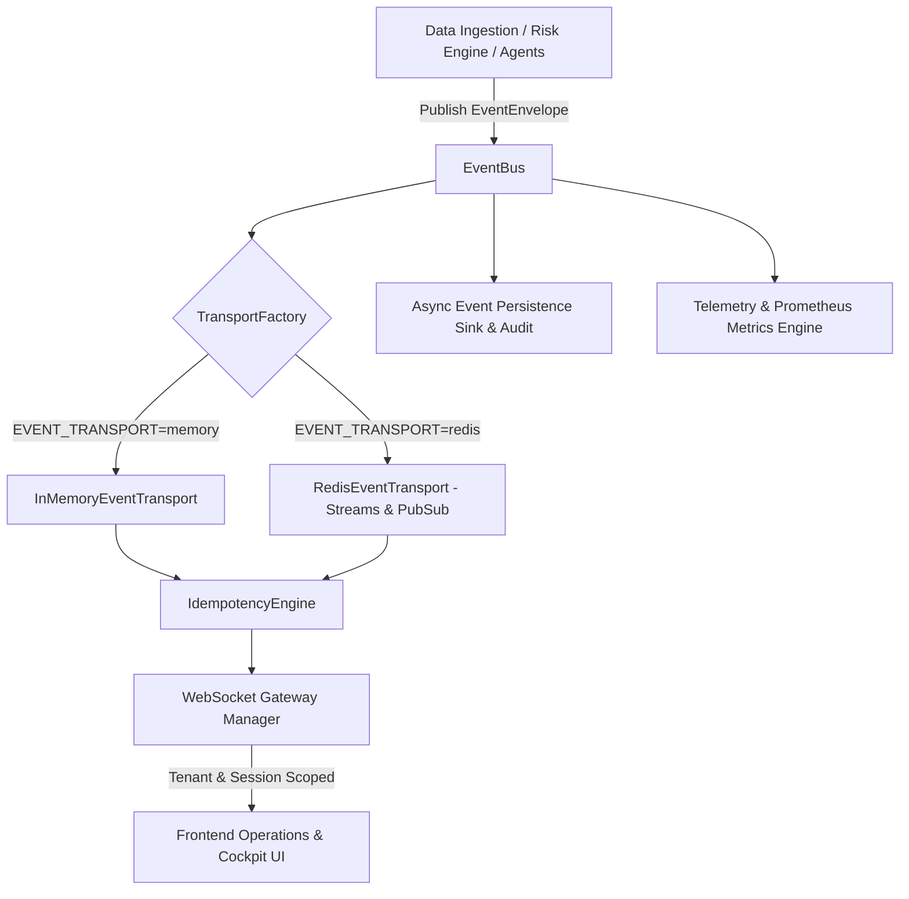

# Distributed Realtime Architecture

## 1. Vision & Architecture Overview
FULFILL-X Phase 5 evolves the in-process event architecture into a production-capable, observable, horizontally extensible event-driven system while maintaining strict **Free-First, Local-First, Zero-Trust, and Multi-Tenant** principles.

---

## 2. Event Flow & Transport Layer

---

## 3. Core Architectural Guarantees
1. **Free-First Default**: Single-instance development runs 100% in memory (`EVENT_TRANSPORT=memory`) with zero required external dependencies.
2. **Horizontal Redis Extensibility**: `RedisEventTransport` uses Redis Streams consumer groups (`xadd`, `xreadgroup`, `xclaim`) with automatic fallback to memory if Redis is unconfigured or offline.
3. **Idempotency & Deduplication**: Event processing is deduplicated by `(organization_id, event_id, consumer_id)`.
4. **Tenant Isolation**: Event envelope filtering enforces `organization_id` boundaries across event bus, WebSocket streaming, and replay endpoints.
