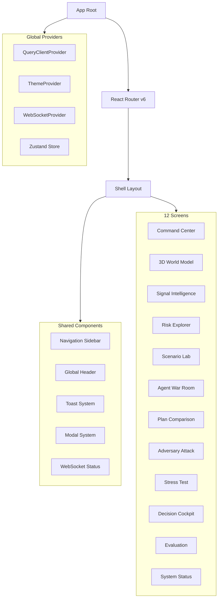

# FULFILL-X — Frontend Specification

## 1. Purpose

Define the complete frontend architecture, technology stack, component
hierarchy, screen specifications, state management strategy, and
implementation patterns for the FULFILL-X UI.

## 2. Technology Stack

| Technology | Version | Role |
|-----------|---------|------|
| React | 18.x | UI framework |
| TypeScript | 5.x | Type safety |
| Vite | 5.x | Build tool + dev server |
| Tailwind CSS | 3.x | Utility-first styling |
| shadcn/ui | latest | Accessible component library |
| React Three Fiber | 8.x | 3D React bindings |
| Three.js | 0.165.x | WebGL 3D engine |
| @react-three/drei | 9.x | Three.js utilities |
| Framer Motion | 11.x | Declarative animation |
| GSAP | 3.x | Imperative timeline animation |
| Recharts | 2.x | Charting library |
| React Flow | 11.x | Node-edge flow diagrams |
| Zustand | 4.x | Client state management |
| TanStack Query | 5.x | Server state + caching |
| Lucide React | latest | Icon set |
| React Router | 6.x | Client-side routing |

## 3. Visual Direction

**Enterprise Operational Command Center** — cinematic, precise,
data-dense, restrained, and professional.

- **NOT** a generic SaaS dashboard
- **NOT** excessive cyberpunk/neon decoration
- **IS** a sophisticated dark-themed operational interface
- **IS** data-dense with intentional negative space
- **IS** subtle animation that communicates state, not decoration

Full visual language in `docs/DESIGN_SYSTEM.md`.

## 4. Application Architecture



## 5. State Management Strategy

### Zustand Store Structure

```typescript
interface FulfillXStore {
  // World state
  worldSnapshot: WorldStateSnapshot | null;
  worldLoading: boolean;

  // Active scenario
  activeScenario: ScenarioObject | null;
  scenarioHistory: ScenarioObject[];

  // Agent state
  agentStatuses: Record<AgentId, AgentStatus>;
  agentProposals: AgentProposal[];

  // Plan state
  rankedPlans: RankedPlan[];
  selectedPlan: RankedPlan | null;

  // Signal state
  activeSignals: Signal[];

  // UI state
  selectedNode: NodeId | null;
  selectedEdge: EdgeId | null;
  sidebarCollapsed: boolean;
  activeScreen: ScreenId;

  // WebSocket
  wsConnected: boolean;
  wsLastEvent: WSEvent | null;
}
```

### TanStack Query Usage

| Query Key | Endpoint | Stale Time |
|-----------|---------|-----------|
| `['world']` | `GET /api/world` | 10s |
| `['signals']` | `GET /api/signals` | 5s |
| `['risks']` | `GET /api/risks` | 10s |
| `['scenarios']` | `GET /api/scenarios` | 30s |
| `['plans']` | `GET /api/plans` | 30s |
| `['evaluation']` | `GET /api/evaluation` | 60s |
| `['system']` | `GET /api/system` | 15s |

## 6. Screen Specifications

### Screen 1: Command Center

**Purpose**: Top-level operational overview for the director.

**Layout**: Split — left 40% 2D KPI panel, right 60% mini 3D world + signal feed

**User Actions**:
- View network health score
- See top 3 active risks
- Launch full 3D world view
- Trigger scenario simulation
- Navigate to any other screen

**Data Source**: `/api/world`, `/api/risks`, `/api/signals` + WebSocket

**States**:
- Loading: skeleton cards + spinner
- Empty: "No active signals" placeholder
- Error: error banner with retry
- Active: live KPIs + mini 3D + signal stream

**Animations**:
- KPI cards fade in sequentially (Framer Motion)
- Risk scores pulse on update (CSS)
- Signal feed scrolls with new items animating in

**Accessibility**: All KPIs have `aria-live="polite"` regions

---

### Screen 2: 3D World Model

**Purpose**: Full-screen interactive 3D visualization of the supply network.

**Layout**: Full viewport Three.js canvas + floating 2D control panel

**User Actions**:
- Orbit, pan, zoom the 3D network
- Click nodes/edges to inspect
- Toggle risk heat map overlay
- Toggle route animation
- Filter by node type

**Data Source**: `/api/world` + WebSocket `world.update`

**States**:
- Loading: progress bar + "Loading network..."
- Empty: placeholder globe with "No network data"
- Error: fallback 2D list view
- Active: full 3D network with live updates

**Animations**:
- Camera eases to selected node (GSAP)
- Disruption waves animate outward from affected nodes
- Routes animate with particle flow

**Accessibility**: Keyboard navigation for camera; screen-reader announces node selection

---

### Screen 3: Signal Intelligence

**Purpose**: Feed of all incoming disruption signals with classification and severity.

**Layout**: Left: filterable signal list. Right: signal detail + geographic mini-map.

**User Actions**:
- Filter signals by type, severity, region
- Click signal to see full detail
- Pin signal to watch list
- Promote signal to active scenario

**Data Source**: `/api/signals` + WebSocket `signal.new`

**Animations**: New signals slide in from top. Severity badge pulses on critical.

---

### Screen 4: Risk Explorer

**Purpose**: Multi-dimensional risk visualization with node-level drill-down.

**Layout**: Left: sortable risk table. Center: risk heat map (2D). Right: node risk detail.

**User Actions**:
- Sort nodes by any risk dimension
- Click node to see full risk breakdown
- Change risk time horizon (current / 24h / 7d)
- Export risk report

**Data Source**: `/api/risks` + WebSocket `risk.update`

**Animations**: Risk bars animate on load; color transitions on change.

---

### Screen 5: Scenario Lab

**Purpose**: Compose and simulate compound disruption scenarios.

**Layout**: Left: signal selector. Center: scenario canvas (React Flow). Right: scenario params.

**User Actions**:
- Drag signals onto scenario canvas
- Define concurrent vs. cascading relationships
- Set scenario parameters (duration, magnitude)
- Run simulation
- Save scenario

**Data Source**: `/api/scenarios`, `POST /api/scenarios/simulate`

**Animations**: Simulation results animate as risk wave on mini 3D embed.

---

### Screen 6: Agent War Room

**Purpose**: Live view of all specialist agent activity and proposals.

**Layout**: Agent cards grid (8 agents). Proposal detail panel below.

**User Actions**:
- Monitor agent status (idle / running / complete / error)
- Read each agent's proposal
- See constraint satisfaction scores
- Compare proposals side by side

**Data Source**: WebSocket `agent.started`, `agent.proposal`

**Animations**: Agent cards animate when active (spinning indicator). Proposals fade in.

---

### Screen 7: Plan Comparison

**Purpose**: Side-by-side comparison of all ranked recovery plans.

**Layout**: Horizontal plan cards. Radar chart overlay. Metric table below.

**User Actions**:
- Compare up to 5 plans
- Toggle which metrics to display
- See adversarial weaknesses for each plan
- Select plan for decision cockpit

**Data Source**: `/api/plans` + WebSocket `plan.ranked`

**Animations**: Plans slide in from right. Radar chart animates on load.

---

### Screen 8: Adversary Attack

**Purpose**: View adversary agent findings for each plan.

**Layout**: Plan selector top. Attack tree visualization below. Finding list right.

**User Actions**:
- Select plan to attack
- Trigger adversary re-run
- View attack tree (React Flow)
- See failure scenario for each attack vector

**Data Source**: `/api/plans/{id}/adversary`

**Animations**: Attack tree nodes highlight sequentially. Failure paths animate red.

---

### Screen 9: Stress Test

**Purpose**: Apply multiple concurrent disruptions to stress-test a selected plan.

**Layout**: Plan selector. Stress test parameters panel. Results dashboard.

**User Actions**:
- Select plan to stress test
- Choose stressor combination
- Run stress test
- View pass/fail breakdown

**Data Source**: `POST /api/evaluation/stress`

**Animations**: Progress bar during test run. Results reveal with staggered animation.

---

### Screen 10: Decision Cockpit

**Purpose**: Final decision interface for director to approve a recovery plan.

**Layout**: Full-width selected plan summary. Approve / Reject / Defer controls. Audit log.

**User Actions**:
- Review winning plan summary
- See constraint satisfaction, adversarial rating, metrics
- Approve → triggers state mutation
- Reject with reason → logged
- Defer with note → logged

**Data Source**: `/api/plans/{id}`, `POST /api/plans/{id}/approve`

**Animations**: Approval action has a confirmation modal with dramatic reveal.

---

### Screen 11: Evaluation

**Purpose**: Run and view results from the deterministic evaluation harness.

**Layout**: Test suite list left. Results dashboard right. Historical trend chart bottom.

**User Actions**:
- Run full benchmark suite
- Run individual test
- View pass/fail breakdown
- See performance trends

**Data Source**: `/api/evaluation`, `POST /api/evaluation/run`

**Animations**: Test items check off sequentially as benchmark runs.

---

### Screen 12: System / AWS Status

**Purpose**: Operational health dashboard for all backend services and AWS components.

**Layout**: Service status grid. Latency charts. Event log.

**User Actions**:
- View health of all backend services
- See AI provider status (Gemini / Ollama / Bedrock / Mock)
- View AWS resource metrics
- Switch active AI provider

**Data Source**: `/api/system/health`, `/api/system/providers`

**Animations**: Status indicators pulse green (healthy) or flash red (degraded).

---

## 7. Routing Structure

```
/                     → Redirect to /command
/command              → Screen 1: Command Center
/world                → Screen 2: 3D World Model
/signals              → Screen 3: Signal Intelligence
/risks                → Screen 4: Risk Explorer
/scenarios            → Screen 5: Scenario Lab
/agents               → Screen 6: Agent War Room
/plans                → Screen 7: Plan Comparison
/adversary            → Screen 8: Adversary Attack
/stress               → Screen 9: Stress Test
/decision             → Screen 10: Decision Cockpit
/evaluation           → Screen 11: Evaluation
/system               → Screen 12: System Status
```

## 8. WebSocket Integration

```typescript
// WebSocket event types
type WSEvent =
  | { type: 'world.update'; payload: WorldStateSnapshot }
  | { type: 'risk.update'; payload: RiskScoreMap }
  | { type: 'scenario.created'; payload: ScenarioObject }
  | { type: 'agent.started'; payload: { agentId: AgentId; task: string } }
  | { type: 'agent.proposal'; payload: AgentProposal }
  | { type: 'adversary.finding'; payload: AdversaryFinding }
  | { type: 'plan.ranked'; payload: RankedPlan[] }
  | { type: 'plan.accepted'; payload: AcceptedPlan }
  | { type: 'eval.result'; payload: EvaluationResult };
```

## 9. Performance Targets

| Metric | Target |
|--------|--------|
| First Contentful Paint | < 1.5s |
| Time to Interactive | < 3.0s |
| 3D scene initial render | < 2.0s |
| Route transition | < 200ms |
| WebSocket event to render | < 50ms |
| Bundle size (gzipped) | < 500KB (JS) |

## 10. Testing Plan

- Unit tests: Vitest + React Testing Library for all components
- Integration tests: MSW for API mocking
- E2E tests: Playwright for all 12 screens
- Visual regression: Playwright screenshots
- Accessibility: axe-core via jest-axe

See `docs/TESTING_SPEC.md` for full test plan.
