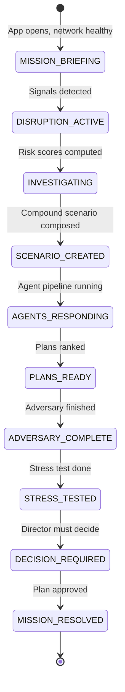

# FULFILL-X — Gamification Specification

## 1. Philosophy

FULFILL-X gamification supports the **operational narrative** and demonstrates
system capability to a live audience. It never trivializes a serious domain.

**Rules:**
- No meaningless points or badges
- No progress bars disconnected from real outcomes
- No childish achievement mechanics
- Every gamification element maps to a **real system event**
- The "game" is: respond to the disruption better than the baseline

---

## 2. Core Narrative: The Mission

Every demo session is framed as an **Operational Mission**:

```
MISSION: Typhoon Hana + Factory Fire Shenzhen
STATUS: ACTIVE DISRUPTION
NETWORK HEALTH: DEGRADED (0.58)
OBJECTIVE: Restore network health to ≥ 0.80 with
           SLA preservation ≥ 0.85 and cost delta < $50K
TIME PRESSURE: Disruption escalates in 72 hours
```

The mission gives the demo a beginning, middle, and end.

---

## 3. Mission States



---

## 4. Operational Milestones

Each milestone triggers a visual feedback moment:

| Milestone | Trigger | Visual Feedback | Sound (optional) |
|-----------|---------|----------------|-----------------|
| **DISRUPTION DETECTED** | First CRITICAL signal | Red flash on 3D world; status bar turns red | Low alert tone |
| **COMPOUND RISK IDENTIFIED** | Scenario simulated | Risk delta panel appears; 3D disruption wave | — |
| **AGENTS DEPLOYED** | Agent pipeline starts | All 8 agent cards animate in | — |
| **PROPOSALS COLLECTED** | All agents complete | "6/6 Agents Complete" progress fills | — |
| **ADVERSARY CHALLENGE** | Adversary runs | Red flash on plan's weak points | — |
| **PLAN VERIFIED** | Stress test passes ≥ 70% | Green "STRESS TESTED" badge on plan | — |
| **MISSION RESOLVED** | Plan approved | 3D world color-shifts toward healthier state; health score climbs | Optional success tone |

---

## 5. Progress Indicators

### 5.1 Network Health Timeline

A sparkline in the status bar shows network health over time:
- X axis: time (last 60 minutes)
- Y axis: network health (0.0 – 1.0)
- Shows the health drop when signals arrive
- Shows recovery after plan approval

This is not gamification for its own sake — it shows the system's impact.

### 5.2 Pipeline Progress

Agent War Room shows a pipeline progress bar:
```
Pipeline: ████████░░ 6/8 Complete · 3.2s
```

This is progress on the real computation — not a fake timer.

### 5.3 Mission Status Badge

Status bar shows mission status:
```
● ACTIVE MISSION · Double Punch · 00:03:47 elapsed
```

Timer starts when scenario is activated. Stops when plan is approved.

---

## 6. Decision Quality Feedback

After plan approval, the Decision Cockpit shows a **Decision Quality Report**:

```
DECISION QUALITY
────────────────────────────────────────────────
SLA Preservation:  0.85 ✓ (target: ≥ 0.80)
Cost Efficiency:   +$38K ✓ (budget: < $50K)
Emissions Control: +8% ✓ (threshold: < +10%)
Adversary Rating:  0.78 ✓ (benchmark: > 0.70)
Stress Survival:   7/10 ✓ (minimum: ≥ 6/10)
────────────────────────────────────────────────
MISSION OUTCOME:   SUCCESS
```

All criteria are real system metrics — not invented scores.

---

## 7. Adversarial Challenge as Drama

The Adversary Agent creates **operational drama**:

1. Plans are announced
2. Audience believes they're done
3. Adversary attacks: "Finding: Manila route collapses at +20% demand"
4. Tension: Will the plan survive?
5. Resolution: Adversary rating 0.78 — "Acceptable risk"

This is **narrative-driven gamification** without any artificial mechanics.

---

## 8. Evaluation Scoreboard

The Evaluation screen shows:
- Benchmark pass rate: `21/23 tests ✓`
- System vs. baseline comparison
- Trend over last 5 runs

This is a **performance leaderboard for the system itself** — how the AI improves.

---

## 9. Demo Mode: Operational Mission Flow

```
T+0:00  App opens → Network starts HEALTHY (green)
T+0:30  Typhoon signal injected → Health drops to 0.82 (amber)
T+1:00  Factory fire signal → Health drops to 0.58 (red/amber)
T+1:30  Signals promoted to compound scenario
T+2:00  Simulation runs → risk delta shown
T+2:30  Agent pipeline starts → 6 cards animate
T+4:30  Agents complete → plans ranked
T+5:00  Adversary attacks → 2 findings surface
T+5:30  Stress test → 7/10 survive
T+6:00  Decision Cockpit → director reviews plan
T+7:00  Plan approved → 3D world recovers → health climbs to 0.81
T+7:30  Decision Quality Report shown
T+8:00  Evaluation screen → benchmarks displayed
T+9:00  AWS architecture shown → cloud infrastructure demonstrated
```

---

## 10. What NOT to Include

| Rejected Mechanic | Reason |
|-------------------|--------|
| XP / Points | No domain relevance |
| Achievement badges | Infantilizes the audience |
| Countdown timer with pressure | Creates fake urgency, not real insight |
| Leaderboard between users | MVP is single-user |
| Random critical event generation | Would break demo reproducibility |
| Sound effects on every action | Distracting in a boardroom |
