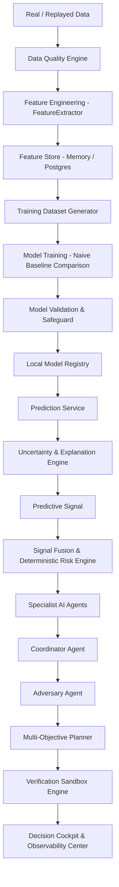

# Predictive AI / ML Architecture

## 1. Vision & Architecture Overview
FULFILL-X Phase 6 introduces a genuine, reproducible, explainable Predictive ML Platform that consumes historical observations, operational parameters, and real-world signal feeds to produce validated predictive risk and demand intelligence.

The predictive layer functions as advisory evidence. It feeds `PredictiveSignal` envelopes into the authoritative, deterministic Risk Engine without mutating World Model state directly.

---

## 2. End-to-End Pipeline

---

## 3. Core Architectural Principles
1. **Free-First Local Default**: Executes 100% locally with `scikit-learn`, `numpy`, `pandas`, `scipy`, and `joblib` without paid APIs or cloud GPUs.
2. **Naive Baseline Safeguard**: Every ML algorithm is evaluated against a simple naive baseline (e.g. 3-step moving average or historical occurrence rate). If ML fails to beat the baseline, `is_baseline_preferred = True` is enforced.
3. **Time-Aware Anti-Leakage**: Datasets use strict chronological splits ($70\%$ train, $15\%$ val, $15\%$ test) without random shuffling.
4. **Deterministic Reproducibility**: All dataset generators and training pipelines run with seed `42`.
