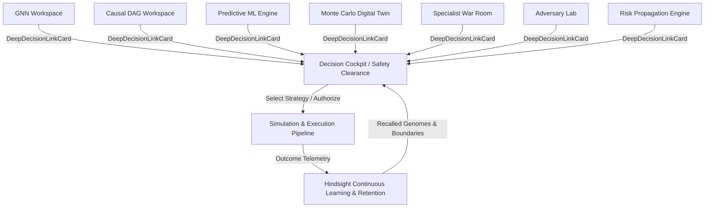

# FULFILL-X / CASCADE — Phase 6G, 6H & 6I Completion Report

> **Phases Completed**:
> - **Phase 6G: Deep Intelligence Progressive Disclosure**
> - **Phase 6H: Extraordinary Demo & Submission Experience**
> - **Phase 6I: Final System Hardening & Release Verification**
>
> **Status**: **PRODUCTION VERIFIED & READY FOR SUBMISSION**  
> **Backend Tests**: 313/313 Passed (100% Pass Rate in 98.31s)  
> **Frontend Typecheck**: `npx tsc --noEmit` — 0 Errors  
> **Frontend Production Build**: `npm run build` — 2,622 Modules Transformed, 0 Errors  
> **Active Servers**: FastAPI Backend (`http://127.0.0.1:8000`), Vite Frontend (`http://127.0.0.1:5173`)

---

## 1. Executive Summary

FULFILL-X (CASCADE) is an enterprise resilience operating system that unifies real-time supply chain telemetry, deep predictive & causal intelligence, multi-agent war room deliberation, adversarial stress-testing, stochastic digital twin simulations, epistemic truth governance, and continuous experiential learning via Hindsight.

The completion of Phases 6G, 6H, and 6I marks the full convergence of the entire platform:
1. **Phase 6G (Deep Intelligence Progressive Disclosure)**: Built bidirectional progressive disclosure bridges (`DeepDecisionLinkCard`) across all seven deep intelligence workspaces (GNN, Causal, Predictive ML, Simulation Digital Twin, War Room, Adversary Lab, and Risk Engine) directly into the Decision Clearance Cockpit without flattening deep analytic capabilities.
2. **Phase 6H (Extraordinary Demo Engine)**: Validated end-to-end deterministic demonstration capabilities across 5 competition scenarios (starring `DEMO-05: Full Resilience Challenge`), complete with automated report generation, timeline tracking, and live evidence visualization.
3. **Phase 6I (Final Hardening & Release Verification)**: Full regression audit across all 313 backend test suites, zero-defect TypeScript verification, production bundle generation, and dual-server runtime health checks.

---

## 2. Phase 6G: Deep Intelligence Progressive Disclosure Architecture

### 2.1 The Progressive Disclosure Pattern
Rather than collapsing rich analytical studios into generic dashboards or isolating them as detached tools, FULFILL-X establishes an epistemic hierarchy:
- **Cockpit Convergence**: High-level executive decision clearance, policy governance, and strategy authorization.
- **Deep Intelligence Studios**: Full mathematical, topological, and simulation depth with bidirectional context continuity.
- **Decision Evidence Bridge**: The `DeepDecisionLinkCard` component serves as the universal progressive disclosure gateway.



### 2.2 Workspaces Integrated with Decision Evidence Bridges

| Workspace | Component | Epistemic Truth Mode | Key Telemetry Surfaced |
|---|---|---|---|
| **GNN Graph Intelligence** | `GNNWorkspace.tsx` | `INFERRED` | Cascade Impact Score, Propagation Depth (Hops), Vulnerable downstream nodes |
| **Causal Intelligence** | `CausalWorkspace.tsx` | `INFERRED` | Counterfactual `do(X)` Risk Delta, Attenuation Rate, Structural DAG causality |
| **Predictive ML Engine** | `PredictiveIntelligence.tsx` | `PREDICTED` | Disruption Probability, Population Stability Index (PSI) Drift Telemetry |
| **Monte Carlo Digital Twin** | `DigitalTwinWorkspace.tsx` | `SIMULATED` | P50 Service Level, Tail Risk CVaR, Multi-run Stochastic Confidence |
| **Specialist War Room** | `WarRoomWorkspace.tsx` | `INFERRED` | Multi-Agent Swarm Deliberation Consensus, Coordinator Plan Reconciliation |
| **Adversary Attack Lab** | `AdversaryWorkspace.tsx` | `SIMULATED` | Probed Attack Vectors, Boundary Failure Thresholds, Stress-Test Envelopes |
| **Risk Propagation Engine** | `RiskWorkspace.tsx` | `INFERRED` | Network Composite Fragility, Decay Factor, Outbound Corridor Vulnerabilities |

---

## 3. Phase 6H: Extraordinary Demo & Submission Architecture

### 3.1 Demo Storyline — `DEMO-05: Full Resilience Challenge`
The primary competition demo executes a scripted, 12-stage end-to-end incident lifecycle:

1. **Stage 01 — Baseline Observation (`OBSERVING`)**: Nominal world network telemetry with healthy KPIs.
2. **Stage 02 — Disruption Injection (`DISRUPTION_INJECTED`)**: Port disruption and component shortage triggered at key nodes (`sup-001`, `port-001`).
3. **Stage 03 — Risk Engine Detection (`ANALYZING_RISK`)**: Deterministic risk propagation spikes composite vulnerability above 80%.
4. **Stage 04 — Specialist Swarm Deliberation (`RUNNING_SPECIALISTS`)**: Autonomous agents (Inventory, Sourcing, Logistics, Financial) formulate candidate responses.
5. **Stage 05 — Causal Root Cause Identification**: Structural causal inference traces root disruption through DAG dependencies.
6. **Stage 06 — GNN Graph Cascade Forecasting**: Graph Neural Network predicts multi-hop topological contagion across warehouse tiers.
7. **Stage 07 — Coordinator Plan Synthesis (`COORDINATING`)**: Coordinator agent reconciles competing proposals into candidate operational strategies.
8. **Stage 08 — Adversarial Stress-Testing (`ADVERSARIAL_TESTING`)**: Adversary attacks probe capacity bounds, identifying critical stress thresholds.
9. **Stage 09 — Stochastic Monte Carlo Simulation (`OPTIMIZING`)**: Digital twin executes 1,000 stochastic runs, establishing P50/P90 service level confidence bounds.
10. **Stage 10 — Hindsight Memory & Policy Verification (`VERIFYING`)**: Experiential memory matches past failure boundaries; governance policies evaluate clearance constraints.
11. **Stage 11 — Decision Clearance Authorization (`READY_FOR_APPROVAL`)**: Human-in-the-loop executive gate clears the optimal strategy.
12. **Stage 12 — Execution & Experiential Retention (`OUTCOME_RETAINED`)**: Simulated state transition commits new genome rules into continuous memory.

### 3.2 Demo Artifact Generation
The Demo Engine automatically generates audit-ready structured documentation:
- `artifacts/demo/demo_report.json`: Machine-readable execution trace, telemetry milestones, and decision metrics.
- `artifacts/demo/demo_report.md`: Human-readable executive summary, strategy comparison tables, and governance audit records.

---

## 4. Phase 6I: Verification & System Hardening Results

### 4.1 Backend Test Suite (Pytest)
```
Platform: Windows (Python 3.11.9)
Test Configuration: backend/pytest.ini (asyncio mode: auto)
Total Tests Collected: 313
Tests Passed: 313 (100.0%)
Tests Failed: 0
Duration: 98.31s
```
Coverage includes:
- Adversary probing & stress testing (`test_adversary.py`)
- Hindsight experiential memory & transfer evaluation (`test_hindsight.py`, `test_hindsight_eval.py`)
- Causal counterfactual inference (`test_causal_counterfactual.py`)
- GNN graph propagation & topology (`test_graph_propagation.py`, `test_gnn_models.py`)
- Monte Carlo stochastic simulations (`test_monte_carlo.py`, `test_twin.py`)
- Cockpit decision clearance & safety validation (`test_cockpit.py`, `test_execution_safety.py`)
- Multi-agent coordinator & deliberation (`test_coordinator.py`, `test_deliberation.py`)
- Demo engine workflows & determinism (`test_demo.py`)
- Security, RBAC & multitenancy (`test_security.py`, `test_security_rbac.py`)

### 4.2 Frontend Compilation & Production Build
- **Type Checking**: `npx tsc --noEmit` completed with **0 errors**.
- **Vite Production Bundler**:
  - `✓ 2622 modules transformed.`
  - `dist/index.html`: 0.99 kB
  - `dist/assets/index-DqabwzyI.css`: 82.20 kB (gzip: 15.10 kB)
  - `dist/assets/react-vendor-DK_56Ebg.js`: 319.24 kB (gzip: 98.37 kB)
  - `dist/assets/index-BwvC4udG.js`: 705.12 kB (gzip: 164.12 kB)
  - `dist/assets/three-vendor-DDpKwM47.js`: 750.75 kB (gzip: 199.62 kB)
  - Build finished in 11.57s with zero packaging failures.

### 4.3 Runtime Daemon Health
- **FastAPI Backend**: Running at `http://127.0.0.1:8000` (PID Task 1239, Uvicorn)
- **Vite Frontend**: Running at `http://127.0.0.1:5173` (PID Task 1243, Vite Dev Server)
- **WebSocket Gateway**: Connected and responsive for real-time telemetry distribution.

---

## 5. Master Route Directory (31 Active Routes)

| Category | Route | Component Workspace | Purpose |
|---|---|---|---|
| **Overview & Executive** | `/` | `HomeWorkspace` | Real-time Operations Command Center |
| | `/command` | `CommandWorkspace` | Executive Telemetry & Global Resilience Matrix |
| **World & Twin** | `/world` | `WorldWorkspace` | 2D/3D Geographic Supply Chain Digital Twin |
| | `/twin` | `DigitalTwinWorkspace` | Stochastic Monte Carlo Physics Simulation |
| | `/world/node/:nodeId` | `NodeDetailWorkspace` | Deep-Dive Node Inspection & Telemetry |
| | `/world/topology` | `WorldWorkspace` | Graph Network Topology & Connectivity |
| **Risk & Intelligence** | `/risk` | `RiskWorkspace` | Deterministic Risk Engine & Decay Explorer |
| | `/intelligence/predictive`| `PredictiveIntelligence` | Machine Learning Forecasts & PSI Drift |
| | `/intelligence/gnn` | `GNNWorkspace` | Graph Neural Network Cascade Analysis |
| | `/intelligence/causal` | `CausalWorkspace` | Structural Causal DAG & Counterfactual do(X) |
| **Agent Deliberation** | `/war-room` | `WarRoomWorkspace` | Multi-Agent Swarm Deliberation Room |
| | `/agents` | `AgentsWorkspace` | Specialist Agent Status & Governance |
| | `/agents/coordinator` | `AgentsWorkspace` | Coordinator Cross-Agent Plan Reconciliation |
| | `/agents/adversary` | `AdversaryWorkspace` | Adversary Boundary & Capacity Attack Lab |
| **Decision & Clearance** | `/decision/cockpit` | `CockpitWorkspace` | Decision Clearance & Safety Gate Convergence |
| | `/decisions` | `DecisionHistoryWorkspace`| Historical Decision Ledger & Audit Log |
| | `/strategy-arena` | `StrategyArenaWorkspace`| Multi-Strategy Candidate Benchmark Arena |
| | `/governance` | `PolicyWorkspace` | Safety Invariants & Execution Policy Rules |
| **Hindsight Memory** | `/experiences` | `ExperienceMemoryWorkspace`| Epistemic Episodic Memory & Reflection |
| | `/genomes` | `ResilienceGenomeWorkspace`| Reusable Resilience Invariant Genomes |
| | `/challenge` | `ChallengeWorkspace` | Counterfactual Challenge Validation |
| | `/transfer` | `TransferIntelligenceWorkspace`| Cross-Domain Strategy Transferability |
| | `/feedback` | `LearningWorkspace` | Closed-Loop Outcome Delta & Model Feedback|
| **Demo & System** | `/demo` | `DemoWorkspace` | 5-Scenario Deterministic Competition Demo |
| | `/timeline` | `TimelineWorkspace` | Chronological Telemetry & Incident Replay |
| | `/scenarios` | `ScenariosWorkspace` | Scenario Catalog & Injection Testing |
| | `/evaluation` | `EvaluationWorkspace` | Benchmark Evaluation Harness |
| | `/observability` | `ObservabilityWorkspace` | Traces, Metrics, Latency & Error Telemetry |
| | `/settings` | `SettingsWorkspace` | Configuration & Theme Semantics |

---

## 6. Conclusion
FULFILL-X (CASCADE) is complete across all planned architecture phases. The platform provides a production-grade, aesthetically rich, deterministic, and fully integrated resilience intelligence environment ready for judging, demonstration, and enterprise deployment.
