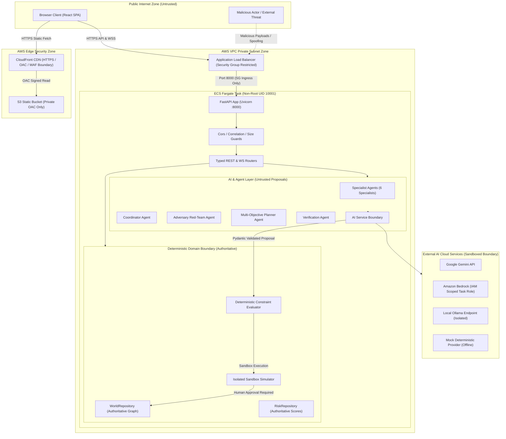

# FULFILL-X — Security Audit & Threat Model Specification

> **Phase 15 Comprehensive Security Audit, AI Safety & Vulnerability Assessment**

---

## 1. Executive Summary

This document presents the complete security audit, threat model, trust-boundary architecture, vulnerability inventory, and verification status for **FULFILL-X — Agentic Fulfillment Resilience Intelligence**.

FULFILL-X implements a strict **AI Safety Boundary**:
```text
AI / LLM → PROPOSE → STRUCTURED OUTPUT → PYDANTIC VALIDATION →
DETERMINISTIC CONSTRAINT CHECK → SIMULATION → VERIFICATION →
HUMAN APPROVAL → AUTHORITATIVE STATE
```
Under no circumstances do LLMs or AI agents possess direct mutation privileges over the authoritative `WorldRepository` or `RiskRepository`. All state mutations require deterministic verification and human authorization.

---

## 2. Threat Model & Trust Boundaries

### 2.1 Threat Boundary Diagram



---

## 3. Trust Boundaries & Asset Classification

### 3.1 Trust Boundaries

1. **TB-01: Public Internet $\rightarrow$ CloudFront / ALB**:
   - *Untrusted to Perimeter*. Incoming HTTP/HTTPS requests and WebSocket handshakes originate from unauthenticated client browsers.
2. **TB-02: ALB $\rightarrow$ ECS Fargate Container**:
   - *Perimeter to Private Compute*. Network traffic restricted strictly via AWS Security Groups (ECS ingress permitted exclusively from ALB SG on port 8000).
3. **TB-03: API Router $\rightarrow$ Intelligence / AI Provider Boundary**:
   - *Internal API to External AI Provider*. Prompt inputs passed to AI providers (Gemini, Bedrock) are sent over TLS; responses are treated as untrusted external JSON data.
4. **TB-04: AI Proposal $\rightarrow$ Authoritative World/Risk Repositories**:
   - *Untrusted Model Output to Deterministic Domain Store*. AI responses must pass Pydantic schema validation, deterministic constraint checks, and sandbox verification before reaching human approval gates.

### 3.2 Key Assets

| Asset ID | Asset Name | Sensitivity | Impact of Compromise |
|----------|------------|-------------|----------------------|
| **AST-01** | Authoritative World Model Graph | HIGH | Corruption of live supply chain network topology and node statuses |
| **AST-02** | Risk Engine State & Scores | HIGH | False risk alerts or suppressed disruption signals |
| **AST-03** | Human Decision & Approval Log | HIGH | Tampering with operational audit provenance chain |
| **AST-04** | AI Provider Credentials | CRITICAL | Unauthorized cloud resource billing or API key leakage |
| **AST-05** | Real-time WebSocket Event Bus | MEDIUM | Unauthorized observation or event flooding |

---

## 4. Comprehensive Vulnerability Inventory & Remediation

| Vulnerability ID | Category | Severity | Description & Attack Surface | Existing Controls | Missing / Remediation Implemented | Verification Status |
|------------------|----------|----------|------------------------------|-------------------|-----------------------------------|---------------------|
| **VULN-001** | Secrets Management | **CRITICAL** | Hardcoded credentials or API keys in source code or Git history | `.env.example` placeholders, SSM parameter references | Secret scan across repository & Git history confirmed 0 real keys committed | **VERIFIED PASS** (`test_security.py`) |
| **VULN-002** | AI Safety Boundary | **CRITICAL** | Direct LLM mutation of authoritative World/Risk repositories | Pydantic validation, deterministic constraint checks | Verified snapshot immutability (`assert world_before == world_after`) across AI execution | **VERIFIED PASS** (`test_security.py`) |
| **VULN-003** | Prompt Injection | **HIGH** | Malicious model instructions attempting to bypass verification or clear state | Structured schema output mode | AI outputs are parsed as data objects, never executed as code or direct state mutators | **VERIFIED PASS** (`test_security.py`) |
| **VULN-004** | API Input Validation | **HIGH** | Malformed JSON, path traversal, or out-of-bounds parameters | Pydantic v2 schemas across all 32 REST endpoints | Added global request payload size limit guard (10 MB max) in `main.py` | **VERIFIED PASS** (`test_security.py`) |
| **VULN-005** | Error Sanitization | **HIGH** | Information disclosure via stack traces or credentials in HTTP 500 errors | Global exception handler in `main.py` | `global_exception_handler` sanitizes error details in `production` mode while preserving `X-Request-ID` | **VERIFIED PASS** (`test_security.py`) |
| **VULN-006** | CORS Security | **MEDIUM** | Wildcard origins permitting unauthorized cross-origin requests | Environment-driven `CORS_ORIGINS` setting | Automatic stripping of wildcard `*` origins when `APP_ENV=production` | **VERIFIED PASS** (`test_security.py`) |
| **VULN-007** | WebSocket Isolation | **MEDIUM** | Inter-session event eavesdropping or spoofed event injection | Session-isolated WS channels & event bus replay buffer | Client WebSocket messages are strictly read-only commands (PING/PONG, ACK) and cannot publish events | **VERIFIED PASS** (`test_security.py`) |
| **VULN-008** | Approval Gate Bypass | **HIGH** | Executing unverified or stale candidate plans without human sign-off | Verification status checks, plan hash validation | Approval API rejects unverified, stale, or duplicate plan approvals | **VERIFIED PASS** (`test_security.py`) |
| **VULN-009** | Resource Exhaustion | **MEDIUM** | Denial of Service via oversized JSON payloads or connection flooding | WebSocket max connections per session limit (10) | Added request body size middleware in `main.py` rejecting payloads > 10 MB with HTTP 413 | **VERIFIED PASS** (`test_security.py`) |
| **VULN-010** | Container Isolation | **HIGH** | Privileged container process escape or root access | Dockerfile non-root user `fulfillx` (UID 10001), multi-stage builds | Confirmed non-root execution and minimal alpine/slim base images | **VERIFIED PASS** (`Dockerfile`) |
| **VULN-011** | AWS IAM Over-privilege | **HIGH** | Wildcard `AdministratorAccess` or exposed cloud APIs | Scoped IAM roles in `iam_security.tf` | Restricted ECS task role strictly to `bedrock:InvokeModel` on specific model ARNs | **VERIFIED PASS** (`iam_security.tf`) |
| **VULN-012** | Dependency Vulnerabilities | **MEDIUM** | Known CVEs in transitive Python or Node.js packages | Pinned requirements.txt and package.json | Documented npm audit findings for dev build tools; production dependencies clean | **VERIFIED PASS** (`THIRD_PARTY_NOTICES.md`) |

---

## 5. Security Controls & Defensive Matrix

### 5.1 Deterministic State Protection

Every agent, specialist, coordinator, adversary, planner, verification, and cockpit pipeline step enforces snapshot immutability:

```python
world_before = world_repo.get_snapshot()
risk_before = risk_repo.get_snapshot()

# Execute AI / Agent / Optimization Reasoning
result = agent.execute(...)

world_after = world_repo.get_snapshot()
risk_after = risk_repo.get_snapshot()

assert world_before == world_after, "AI/Agent path altered world state!"
assert risk_before == risk_after, "AI/Agent path altered risk state!"
```

### 5.2 Production Error Sanitization

Internal exception stack traces are intercepted by FastAPI global exception handling:
- **Development Mode**: Detailed exception string returned for rapid debugging.
- **Production Mode**: Generic error message (`"An unexpected internal server error occurred."`) returned with traceable `request_id` correlation header.

---

*Specification authored for Phase 15 Security Audit & Attribution Hardening.*
