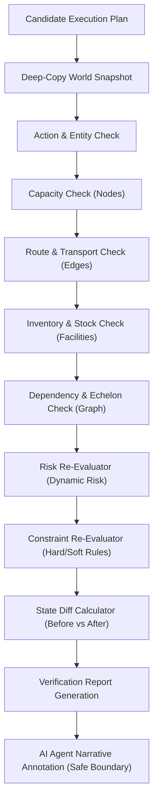

# FULFILL-X — Verification & Validation Engine Specification

## 1. Executive Overview

The **Verification & Validation Engine** (Phase 09) serves as the authoritative, non-destructive simulation boundary within FULFILL-X. Following the architectural pattern:

$$\text{Specialists propose} \rightarrow \text{Coordinator reconciles} \rightarrow \text{Adversary attacks} \rightarrow \text{Planner optimizes} \rightarrow \text{VERIFICATION ENGINE} \rightarrow \text{Human approves}$$

The Verification Engine receives candidate execution plans (e.g. Plan A, Plan B, Plan C from the Multi-Objective Planner or Coordinator) and evaluates them against 6 deterministic validation dimensions:
1. **Action Completeness & Entity Integrity**: Validates that all target entities exist in the current topology snapshot and action parameters are well-formed.
2. **Facility Capacity Constraints**: Simulates throughput, processing, and volume loading on warehouses, ports, and fulfillment centers to prevent overload (`utilization > 100%`).
3. **Transport & Logistics Route Integrity**: Checks edge status, operational disruptions, capacity limits, and delay projections for re-routed flows.
4. **Inventory & Stock-out Prevention**: Tracks projected stock levels at all node locations to prevent negative inventory and flag safety stock threshold violations.
5. **Graph & Supply Chain Dependency Integrity**: Ensures multi-echelon dependency chains remain unbroken (e.g., supplier-to-warehouse-to-FC flows).
6. **Systemic Risk & Constraint Re-validation**: Re-evaluates compound risk scores and hard/soft operational constraints post-simulation.

---

## 2. Immutability & State Safety Guarantee

### Fundamental Invariant
$$\text{WorldState}_{\text{Authoritative}}^{\text{Before}} \equiv \text{WorldState}_{\text{Authoritative}}^{\text{After}}$$

All verification simulations execute strictly within isolated in-memory deep copies of the world model snapshot (`WorldStateSnapshot.model_copy(deep=True)`). 

### Proof of Immutability
`VerificationService` asserts immutability before returning any verification report:
- `world_before == world_after` (comparing pre-run and post-run snapshots of `WorldRepository`)
- `risk_before == risk_after` (comparing pre-run and post-run risk maps of `RiskRepository`)

---

## 3. Verification Status Taxonomy

The Verification Engine categorizes candidate plans into three authoritative statuses:

| Status | Threshold / Condition | Meaning |
| :--- | :--- | :--- |
| `VERIFIED` | 0 Critical Errors, 0 Hard Constraint Violations, Pass Rate = 100% | Plan is fully safe for execution; zero risk of stock-out or capacity breach. |
| `CONDITIONAL` | 0 Critical Errors, 1+ Warnings (e.g. Safety stock drop or soft constraint warning) | Plan is executable but carries operational friction; requires human review of warnings. |
| `REJECTED` | 1+ Critical Errors (Negative stock, blocked route, capacity over-utilization, hard constraint breach) | Plan is unsafe and rejected; execution would cause systemic failure. |

---

## 4. Deterministic Simulation Flow

---

## 5. Verification Metrics & Delta Scoring

Each verification report computes explicit before-versus-after operational metrics:

- **Max Node Utilization**: Baseline vs Projected Peak % Utilization
- **Average Transport Delay**: Baseline vs Projected Edge Delay (Hours)
- **High-Risk Node Count**: Number of nodes with composite risk score $> 0.60$
- **Total Operational Cost & Carbon Footprint**: Cumulative financial and environmental impact of action execution
- **Constraint Compliance Rate**: $\%$ of hard and soft operational constraints satisfied post-simulation

---

## 6. Verification REST API Endpoints

- `GET /api/verification/status`: Health check & active engine telemetry
- `POST /api/verification/run`: Runs complete verification analysis on candidate plans
- `POST /api/verification/simulate`: Executes isolated sandbox simulation for custom candidate actions
- `GET /api/verification/report`: Retrieves cached or latest verification report by plan ID
