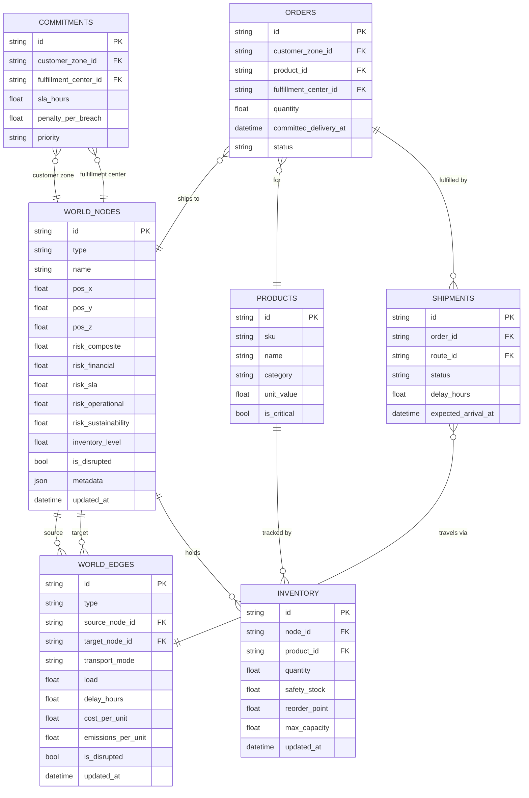
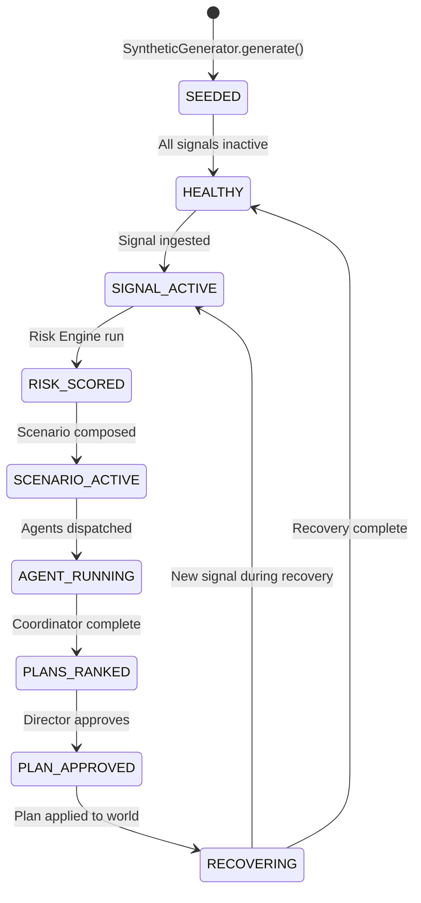

# FULFILL-X — World Model Specification

## 1. Purpose

Define every entity in the FULFILL-X world model: its attributes, relationships,
state machine, constraints, risk effects, and representation in UI and 3D.

The World Model is the **authoritative, graph-structured representation** of the
supply network. It is the single source of truth for all engines, agents, and UI.

---

## 2. Entity Inventory

| Entity | Table | Type |
|--------|-------|------|
| Supplier | `world_nodes` | Node (SUPPLIER) |
| Warehouse | `world_nodes` | Node (WAREHOUSE) |
| FulfillmentCenter | `world_nodes` | Node (FULFILLMENT_CENTER) |
| CustomerZone | `world_nodes` | Node (CUSTOMER_ZONE) |
| Port | `world_nodes` | Node (PORT) |
| Route | `world_edges` | Edge (ROUTE) |
| Dependency | `world_edges` | Edge (DEPENDENCY) |
| Product | `products` | Catalog entity |
| InventoryRecord | `inventory` | Position entity |
| Order | `orders` | Demand entity |
| Shipment | `shipments` | Transit entity |
| Commitment | `commitments` | SLA entity |

---

## 3. Entity Definitions

### 3.1 Supplier

| Attribute | Type | Description | Constraints |
|-----------|------|-------------|------------|
| `id` | string | Unique node ID | Prefix: `sup-` |
| `type` | NodeType | `SUPPLIER` | Fixed |
| `name` | string | Human-readable name | Max 120 chars |
| `tier` | int | Supply chain tier (1=direct, 2=indirect) | 1–3 |
| `position` | Position3D | 3D scene coordinates | |
| `risk_scores` | NodeRiskScores | Multi-dim risk | All in [0,1] |
| `inventory_level` | float | Current stock ratio | [0.0, 1.0] |
| `capacity` | float | Maximum throughput units/day | > 0 |
| `is_disrupted` | bool | Active disruption flag | |
| `disruption_source_ids` | list[str] | Which signals caused disruption | |
| `qualification_score` | float | Supplier quality rating | [0.0, 1.0] |
| `lead_time_days` | float | Standard lead time | > 0 |
| `tags` | list[str] | e.g. `["tier-1", "electronics"]` | |
| `region` | string | Geographic region | |
| `is_alternative_available` | bool | Has qualified alternative | |

**State Machine**:
```
HEALTHY → DEGRADED → DISRUPTED → RECOVERING → HEALTHY
```

**Risk Effects**: Disrupted supplier increases financial + SLA risk in downstream nodes.

**3D**: Sphere geometry, color by risk score, size by capacity.

---

### 3.2 Warehouse

| Attribute | Type | Description |
|-----------|------|-------------|
| `id` | string | Prefix: `wh-` |
| `type` | NodeType | `WAREHOUSE` |
| `name` | string | |
| `position` | Position3D | |
| `risk_scores` | NodeRiskScores | |
| `inventory_level` | float | [0.0, 1.0] — ratio of current/max |
| `capacity_units` | float | Maximum storage units |
| `utilization` | float | Current utilization ratio [0,1] |
| `is_disrupted` | bool | |
| `safety_stock_threshold` | float | Reorder trigger level [0,1] |
| `region` | string | |

**State Machine**:
```
HEALTHY → AT_RISK (inventory near threshold) → CRITICAL (stockout) → DISRUPTED
```

**Risk Effects**: Low inventory → stockout risk → SLA risk to downstream FCs.

**3D**: Box geometry, color by risk, scale by inventory level.

---

### 3.3 FulfillmentCenter

| Attribute | Type | Description |
|-----------|------|-------------|
| `id` | string | Prefix: `fc-` |
| `type` | NodeType | `FULFILLMENT_CENTER` |
| `name` | string | |
| `position` | Position3D | |
| `risk_scores` | NodeRiskScores | |
| `capacity_orders_per_day` | float | Maximum throughput |
| `current_backlog` | int | Outstanding orders |
| `utilization` | float | [0, 1] |
| `is_disrupted` | bool | |
| `sla_at_risk_count` | int | Orders at risk of SLA breach |

**3D**: Octahedron geometry, color by risk.

---

### 3.4 CustomerZone

| Attribute | Type | Description |
|-----------|------|-------------|
| `id` | string | Prefix: `cz-` |
| `type` | NodeType | `CUSTOMER_ZONE` |
| `name` | string | |
| `position` | Position3D | |
| `demand_units_per_day` | float | Average demand |
| `sla_commitment_hours` | float | Required delivery time |
| `sla_current_risk` | float | [0,1] probability of breach |
| `region` | string | |

**3D**: Small sphere, neutral color, opacity reflects SLA risk.

---

### 3.5 Port

**NEW ENTITY — not in Phase 00 DATA_MODEL.md**

| Attribute | Type | Description |
|-----------|------|-------------|
| `id` | string | Prefix: `port-` |
| `type` | NodeType | `PORT` |
| `name` | string | e.g. "Port of Osaka" |
| `position` | Position3D | |
| `risk_scores` | NodeRiskScores | |
| `is_disrupted` | bool | |
| `throughput_vessels_per_day` | float | |
| `connected_route_ids` | list[str] | Routes through this port |

**Risk Effects**: Disrupted port propagates HIGH risk to all connected routes, then
to all warehouses served by those routes.

**3D**: Diamond geometry (custom), distinctive to differentiate from supply nodes.

---

### 3.6 Route (Edge)

| Attribute | Type | Description |
|-----------|------|-------------|
| `id` | string | Prefix: `rt-` |
| `type` | EdgeType | `ROUTE` |
| `source_node_id` | string | |
| `target_node_id` | string | |
| `transport_mode` | string | SEA / AIR / ROAD / RAIL |
| `load` | float | Current utilization [0,1] |
| `capacity` | float | Max units/day |
| `delay_hours` | float | Current delay vs. standard |
| `standard_time_hours` | float | Expected transit time |
| `cost_per_unit` | float | |
| `emissions_per_unit` | float | kg CO2e per unit |
| `is_disrupted` | bool | |
| `alternative_route_ids` | list[str] | Known alternatives |

**3D**: Tube geometry with particle flow. Color by status/load.

---

### 3.7 Dependency (Edge)

| Attribute | Type | Description |
|-----------|------|-------------|
| `id` | string | Prefix: `dep-` |
| `type` | EdgeType | `DEPENDENCY` |
| `source_node_id` | string | Depends-on node |
| `target_node_id` | string | Dependent node |
| `dependency_type` | string | SUPPLY / INVENTORY / SLA / COMPONENT |
| `criticality` | float | [0,1] — how critical is this dependency |

Used by Risk Engine for propagation. Not typically visualized directly in 3D (dashed arrow on hover).

---

### 3.8 Product

| Attribute | Type | Description |
|-----------|------|-------------|
| `id` | string | Prefix: `prod-` |
| `sku` | string | Stock-keeping unit code |
| `name` | string | |
| `category` | string | |
| `unit_value` | float | $ value per unit |
| `is_critical` | bool | High-priority SKU flag |

Products are catalog entities; they don't live on the graph directly.
Inventory records link products to nodes.

---

### 3.9 InventoryRecord

| Attribute | Type | Description |
|-----------|------|-------------|
| `id` | string | |
| `node_id` | string | Which node holds this inventory |
| `product_id` | string | Which product |
| `quantity` | float | Current units on hand |
| `safety_stock` | float | Minimum desired quantity |
| `reorder_point` | float | Trigger for reorder |
| `max_capacity` | float | Maximum storable |
| `updated_at` | datetime | |

---

### 3.10 Order

| Attribute | Type | Description |
|-----------|------|-------------|
| `id` | string | Prefix: `ord-` |
| `customer_zone_id` | string | Destination |
| `product_id` | string | |
| `quantity` | float | |
| `committed_delivery_at` | datetime | SLA deadline |
| `status` | string | PENDING / PROCESSING / SHIPPED / DELIVERED / AT_RISK / BREACHED |
| `fulfillment_center_id` | string | Assigned FC |

---

### 3.11 Shipment

| Attribute | Type | Description |
|-----------|------|-------------|
| `id` | string | Prefix: `ship-` |
| `order_id` | string | |
| `route_id` | string | |
| `origin_node_id` | string | |
| `destination_node_id` | string | |
| `departed_at` | datetime | |
| `expected_arrival_at` | datetime | |
| `status` | string | IN_TRANSIT / DELAYED / DISRUPTED / DELIVERED |
| `delay_hours` | float | Cumulative delay |

---

### 3.12 Commitment

| Attribute | Type | Description |
|-----------|------|-------------|
| `id` | string | Prefix: `comm-` |
| `customer_zone_id` | string | |
| `fulfillment_center_id` | string | |
| `sla_hours` | float | Committed delivery window |
| `penalty_per_breach` | float | $ per SLA breach |
| `priority` | string | STANDARD / PREMIUM / CRITICAL |

---

## 4. Entity Relationship Diagram



---

## 5. Synthetic MVP Network

The Phase 01 synthetic generator creates:

```python
SyntheticNetwork(
    suppliers=[
        Supplier("sup-001", "Apex Electronics", tier=1, region="APAC"),
        Supplier("sup-002", "Global Components Ltd", tier=1, region="APAC"),
        Supplier("sup-003", "EuroFab Materials", tier=2, region="EU"),
        Supplier("sup-004", "NA Parts Co", tier=2, region="NA"),
        Supplier("sup-005", "Backup Supply Inc", tier=2, region="NA"),
    ],
    warehouses=[
        Warehouse("wh-001", "APAC Regional Hub", region="APAC"),
        Warehouse("wh-002", "EU Distribution Center", region="EU"),
        Warehouse("wh-003", "NA West Coast Hub", region="NA"),
    ],
    fulfillment_centers=[
        FulfillmentCenter("fc-001", "Primary FC East Asia"),
        FulfillmentCenter("fc-002", "Primary FC North America"),
    ],
    customer_zones=[CZ(f"cz-{i:03d}") for i in range(1, 11)],
    ports=[
        Port("port-001", "Port of Osaka"),
        Port("port-002", "Port of Shanghai"),
        Port("port-003", "Port of Rotterdam"),
    ],
    products=[
        Product("prod-001", "Electronics Module A", critical=True),
        Product("prod-002", "Components Kit B", critical=True),
        Product("prod-003", "Packaging Material", critical=False),
    ],
)
```

---

## 6. World Model State Machine



---

## 7. Validation Rules

- All node IDs are globally unique (no overlap between types)
- All edge source/target IDs reference existing node IDs
- All risk scores are in [0.0, 1.0]
- `inventory_level` is in [0.0, 1.0]
- No route exists between two nodes of the same type (no Supplier→Supplier)
- The supply graph is a DAG (directed acyclic graph) for dependency edges
- At least one alternative supplier exists for each Tier-1 supplier

---

## 8. API Contract

```
GET /api/world
  → WorldStateSnapshot (all nodes + edges)

GET /api/world/nodes/{node_id}
  → WorldNode (full detail)

GET /api/world/edges/{edge_id}
  → WorldEdge (full detail)

GET /api/world/graph
  → Graph adjacency (for frontend React Flow fallback)
```

---

## 9. Tests

```python
# test_world_model.py

def test_synthetic_network_node_counts():
    net = SyntheticDataGenerator(seed=42).generate()
    assert len(net.suppliers) == 5
    assert len(net.warehouses) == 3
    assert len(net.fulfillment_centers) == 2
    assert len(net.customer_zones) == 10
    assert len(net.ports) == 3

def test_all_risk_scores_in_range():
    snapshot = world_engine.get_snapshot()
    for node in snapshot.nodes:
        assert 0.0 <= node.risk_scores.composite <= 1.0

def test_graph_is_valid():
    snapshot = world_engine.get_snapshot()
    node_ids = {n.id for n in snapshot.nodes}
    for edge in snapshot.edges:
        assert edge.source_node_id in node_ids
        assert edge.target_node_id in node_ids

def test_snapshot_is_deterministic():
    gen1 = SyntheticDataGenerator(seed=42).generate()
    gen2 = SyntheticDataGenerator(seed=42).generate()
    assert gen1 == gen2
```
